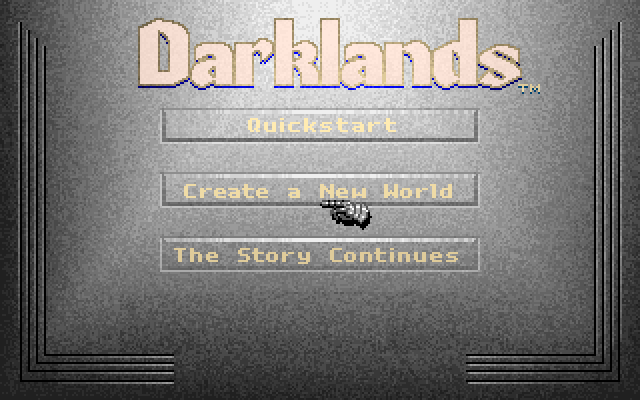
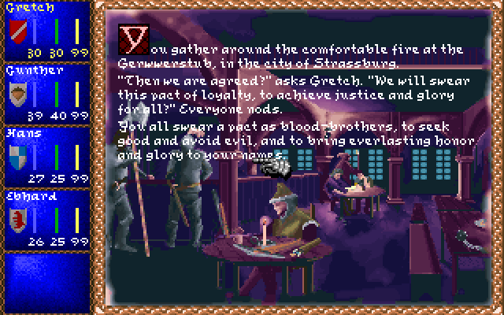
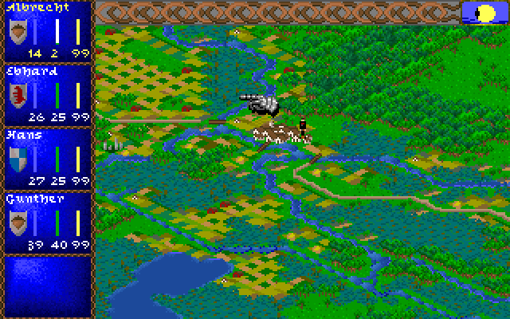
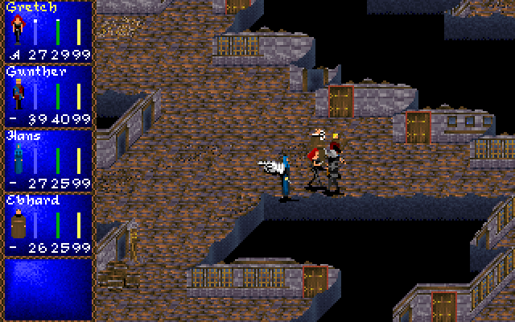
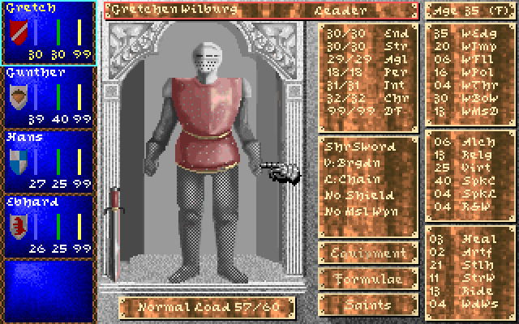
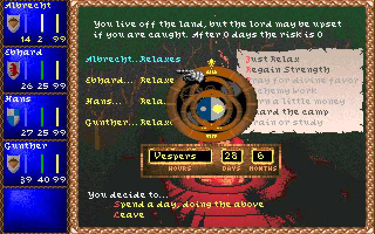

# Darklands Restoration Project

*Darklands* — MicroProse's 1992 role-playing game of 15th-century Germany, its saints, alchemy,
witches and robber knights — rebuilt to run on today's Windows, without DOSBox, and to play exactly
like the original.

<p>






</p>

<sub>Screenshots of version 0.9.0 (`docs/screenshots/0.9.0`): the start screen, a Gasthaus in Strassburg, the
world map, a battle, a character sheet, a night's camp. More: character creation and an inn's choices.</sub>

This is not a remake and not an emulator. Every rule of the original — combat, prices, saints,
alchemy, the cards of every city and encounter, the generators of castles, mines and battlefields —
has been rewritten in C# from the original program, and checked against that program running
function by function. The screens, the music and the sound are the original's, drawn and played from
your own copy of the game.

**You need your own copy of Darklands** (version 483.07, for example the GOG release). Nothing from
the game is included here: the program reads your installation.

## Getting started

1. Get a release (`DarklandsRP.exe` with `SDL2.dll`, `libmt32emu.dll`, `RELEASE_NOTES.md` and an empty `MT32_ROMS`
   folder) and unpack it into a folder of its own.
2. Start `DarklandsRP.exe`. On the first run it opens the launcher, a settings screen before the game: it has found
   your Darklands by itself (GOG, Steam, or a folder next to it), and you can check the game folder, the window, the
   sound card and the Roland ROM folder, and try the sound, then press **Play**. The choices go into
   `darklands.settings.json`, next to the program. Later starts go straight to the game; hold **Shift** while starting
   it (or start it with `--setup`) to see the launcher again. If the game can't be found or can't start, the launcher
   comes up by itself and says why.
3. Play. It starts like the original: the banner, the opening, then the start screen with Quickstart,
   a new world or a saved game.

Saved games go to the game folder's `SAVES`, the same place the original uses, so the two share their
saves both ways. If that folder can't be written (a game under Program Files, as GOG Galaxy installs
it), the saves go to `%APPDATA%\DarklandsRestoration\SAVES` instead and a line at start-up says so; copy
your existing saves (`DKSAVEn.SAV` and `.BSV`) there to keep playing them, or set `"savesFolder"` to
another folder you can write to.

## Playing

The keys and the mouse are the original's: the menu bar with the right button or F10, F1–F5 for the
character sheets, F6 for the party, Ctrl-F1–F5 to choose the leader, Alt-S save, Alt-L load, Alt-P pause,
Alt-O the marching order, Alt-D difficulty, Alt-M music, Alt-F sound effects, Alt-Q quit. Two keys are
this program's own: **F12** saves a screenshot, and **F11** opens a developer console over the game
(`help` lists its commands: time, money, attributes, saints, items...).

## Sound and music

The game's own sound drivers play, as on a 1992 PC: by default the card set up in your copy's
`CONFIG.DRK`, usually a Roland MT-32 for music with a Sound Blaster for speech. For the MT-32 put your
MT-32 or CM-32L ROM files in the `MT32_ROMS` folder that comes with the program, or choose their folder in the
launcher (it shows whether the ROMs of the chosen module are there). Without them the Sound Blaster Pro's FM music
plays instead, and the program says so. The launcher's sound card (`"card"` in the settings) chooses another card:
AdLib, Sound Blaster, Sound Blaster Pro 2, MT-32 or CM-32L.

## Settings

`darklands.settings.json`, next to the program, is commented and shows every default. The ones you may
want:

| Setting | What |
|---|---|
| `gameFolder`, `savesFolder` | where your Darklands is; where the saves go |
| `display.scale`, `display.resolution`, `display.fullscreen` | a bigger window (`2` = 1440x800), any size (`"1600x1000"`), full screen |
| `sound.card`, `sound.mt32Roms` | the sound card; where the MT-32 ROMs are |
| `startup.banner`, `startup.intro` | skip the banner or the opening |

Everything else is in `docs/SETTINGS.md`, which also lists the command-line forms (`--fullscreen`,
`--scale 2`, `--no-intro` and so on).

## Status: version 0.9.5

The whole game plays: character creation, cities and their streets, inns and shops, guilds, banks and
churches, the world map and its encounters, battles, camping, saints and alchemy, saving and loading.
What is knowingly different from the original, and which of the original's bugs are kept (deliberately:
they are part of Darklands), is listed in `docs/faithfulness`. Things not done yet are listed where they
belong (battles: `docs/BATTLES.md`).

Version 1.0 will come when the remaining faithfulness checks are finished.

## License

The Darklands Restoration Project is free software: you can redistribute it and/or modify it under the
terms of the GNU General Public License as published by the Free Software Foundation, either version 3
of the License, or (at your option) any later version. See `LICENSE`.

This covers the project's own code only. *Darklands* itself (© 1992 MicroProse) is not part of it and
not licensed by it; you need your own copy of the game. Third-party components keep their own licences
(see `THIRD_PARTY_NOTICES.md`).

## Community

News, devlogs and the research behind the restoration: https://arkana-mechanika-labs.github.io/ —
questions, bug reports and discussion on the Discord: https://discord.gg/HjzWvmHhqZ

---

## Technical section

### Building

Requirements: the .NET 10 SDK. On Windows the SDL host ships SDL 2; elsewhere install SDL 2 or name the
library in the settings file.

```
dotnet build
dotnet run --project src/Darklands.Host.Sdl -- "C:/GOG Games/Darklands"
```

A release for Windows (`DarklandsRP.exe`, self-contained, with `SDL2.dll`, `libmt32emu.dll`, `RELEASE_NOTES.md` and an
empty `MT32_ROMS` folder beside it, in `artifacts/win-x64`; no .NET installation needed to run it):

```
dotnet publish src/Darklands.Host.Sdl -p:PublishProfile=win-x64
```

A release for Linux x64 (also the Steam Deck: desktop mode and Steam as a non-Steam game; keyboard and mouse as on Windows) is built the same way, with `libmt32emu.so` beside the program (`artifacts/linux-x64`):

```
dotnet publish src/Darklands.Host.Sdl -p:PublishProfile=linux-x64
```

SDL2 is not shipped on Linux: the program uses the system's `libSDL2-2.0.so.0` (Debian/Ubuntu `libsdl2-2.0-0`, already on SteamOS), or a copy placed beside the program. Pack it with `tar` so `DarklandsRP` stays executable (or `chmod +x DarklandsRP`). Without a game folder named, the program looks in Steam's libraries (including the Deck's SD card), Heroic's installed games, the usual GOG/Lutris folders and Wine prefixes (`~/.wine`, `WINEPREFIX`, Lutris, Heroic, Bottles, Proton) before asking. The workflow `.github/workflows/build.yml` builds, tests and publishes both systems.

The launcher shows the release notes: write `releases/<version>/release-notes.md` (beside the repository) before
publishing, and the build puts it next to the program as `RELEASE_NOTES.md`; without it the launcher only links to the
release's page, `releases/tag/v<version>` on GitHub, so tag each release `v<version>`.

The version is set once, in `Directory.Build.props` (`DarklandsRP --version` prints it).

### How it is made

The game logic is a C# reimplementation of `DARKLAND.EXE` 483.07, kept apart from the screens, the
sound and the host: `ARCHITECTURE.md` describes the layers. Each reconstructed operation cites the
place in the original program it reproduces, by its coordinates in the executable
(`docs/TRACEABILITY.md`), and the faithfulness registers in `docs/faithfulness` list every deliberate
difference, every original bug kept, and every open question, each with its reason.

The rules are checked against the original itself: original-byte oracles run each original function
(from your `DARKLAND.EXE`, in an emulated processor) and the C# on the same inputs, over tens of
thousands of cases, and every card of the game runs against its original. A static check compares
every cited function's calls, constants and branches with the executable's bytes, and whole scripted
game sessions run in the original and in the rewrite side by side, compared after every step. See
`docs/faithfulness/SUMMARY.md`.

### Layout

| Folder | What |
|---|---|
| `src/Darklands.Core` | the domain model and the rules, battles included (no I/O) |
| `src/Darklands.Cards` | the card engine and every card script |
| `src/Darklands.Content`, `src/Darklands.Persistence` | the game files; saved games |
| `src/Darklands.Simulation`, `src/Darklands.Presentation` | the game loop; the screens |
| `src/Darklands.Audio`, `src/Darklands.Audio.Mt32` | the sound drivers in an emulated PC; MT-32 |
| `src/Darklands.Platform`, `src/Darklands.Host.*` | host interfaces and settings; the SDL and headless hosts |
| `src/Darklands.DevConsole` | the developer console |
| `src/Darklands.Rendering` | replacement graphics (HD packs) drawn over the game's frame, for any host |
| `tests/` | unit tests, original-byte oracles, card traces |
| `tools/` | oracle corpus builders, faithfulness reports, visual and timing comparisons |
| `docs/` | architecture details, traceability, faithfulness registers, settings, saves, battles, screenshots |

### Tests

```
dotnet test
```

Tests that need the original game read its folder from `DARKLANDS_DIR` (or the executable alone from
`DARKLANDS_EXE`); without them those tests pass without checking anything. The oracle corpora in
`tests/Darklands.Oracle.Tests/Corpus` were produced by running the original functions (`tools/oracle`).

### Third-party components

SDL 2, mt32emu, StbTrueTypeSharp, DejaVu Sans Mono and a VGA text font: see `THIRD_PARTY_NOTICES.md`.
*Darklands* is a 1992 MicroProse game; this project contains none of its files.
