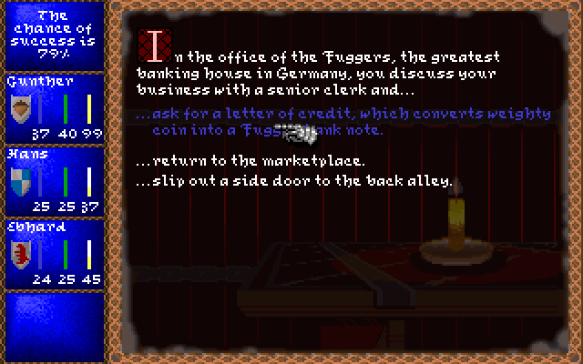
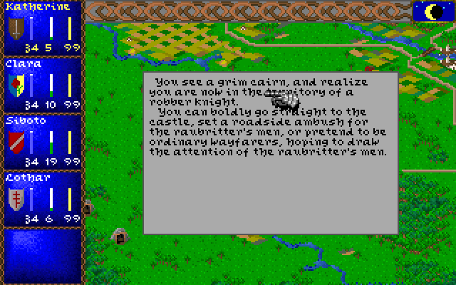
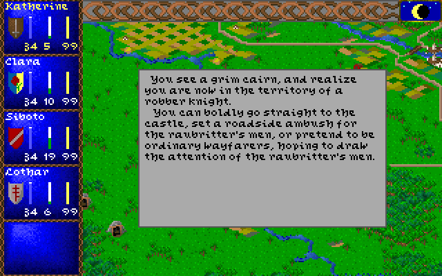
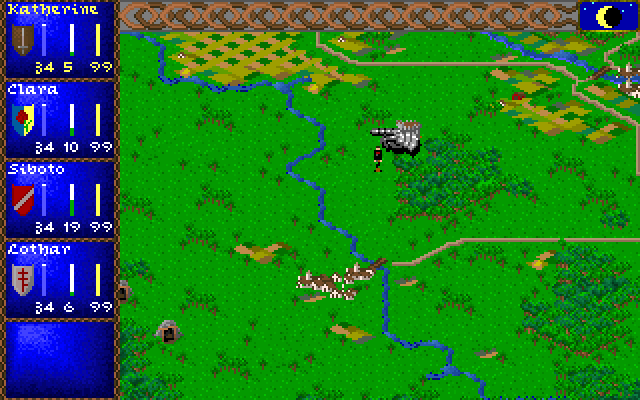

# The Fixed rules

New games play with the **Fixed** rules by default: the 1992 game with its gameplay bugs fixed. **Original** keeps the
1992 rules, bugs included. Both fix the bugs that damage saved games or end the program, and plain display glitches.

Choose in the launcher (Advanced tab, "Rules"), in the settings file (`rules.preset`: `"fixed"` or `"original"`), or for
one run with `--rules fixed` or `--rules original` ([SETTINGS.md](SETTINGS.md#the-rules-preset)). The choice is for new
games only: a saved game keeps the rules it was started with, and a game saved before this version loads as Original. Saved
games stay in the original's format either way, and the 1992 game loads them.

Each fix is a switch of its own, with the original's behaviour kept beside it and tested both ways (the register:
[faithfulness/SWITCHES.md](faithfulness/SWITCHES.md)). What Fixed changes:

## Cards, places and the party

- A timed game event that adds to a value no longer gets twice the value when it is first set.
- Raising an attribute's maximum stays within 0–99.
- Asking for the party's best weapon skill names the best one, not always the same skill.
- Cards that add two attributes together add both, instead of counting the first one twice.
- A city's unrest counts when the game asks whether the city is hostile (the original's test had its terms swapped).
- A card that changes a city's bowyer or gunsmith changes that shop, not the other one.
- A place's list of three remembered values keeps the older values when a new one is added, instead of overwriting them all.
- An item given to every member is given once, not twice.
- A temporary boost for the whole party is taken back when it runs out.
- A saint learned by the leader is learned by the leader (the original learned none and changed another member's formulas).
- St. Cecilia's standing, prayed for in the open country, goes to the nearest city instead of nowhere.
- A saint's weapon-skill effect prayed for the whole party works on the leader's weapons, instead of doing nothing.
- When items may be lost one by one, each item rolls for itself; an empty pack no longer loses the next item picked up.
- Cards that ask for the party's best item of a kind look at each item's own kind.
- Skill and attribute boosts for the whole party give each member the boost once.
- A battle at a place is set up from the party's seed once, not twice.
- Paying fame leaves fame minus the cost, instead of the cost minus fame (often below zero).
- Whether a shop has an item depends on the city's size, not on a leftover value.
- At the university, a failed search for formulas shuts the formulas line for the week, not the saints line.
- At a church at night, the altar boy asked about Mass between 9:00 and 14:59 gives the right answer, not a stray hour.
- A clerk's "come back later" at the town hall or the fortress keeps its promise: the party is welcome there the next day.
- A City Lord's commission given at the fortress (in a city without a town hall) is paid when it is done, as the town hall pays its own.
- A village Schulz's robber-knight task is paid when it is done (ask him for information).
- Alt-L, then Esc on the load screen, goes back to the game as it was (the original went on with an empty party and no events).
- Alchemists sell formulas from the whole range, stronger potions and higher grades included (the original's sold only the
  first seven potions).
- A saint's help or a price set during a battle ends when it should (the original lost it after the battle, so it lasted for good).
- A temporary attribute boost gives back exactly what it added when it ends (the original could leave the attribute lower than
  before when boosts overlapped or met the maximum).
- Claiming friendship with a Hussite band succeeds at the chance shown (the original needed the roll to equal it exactly).
- In the peat bog, a rope lets the party throw a rope (the original asked for a polearm, a bow or metal armour instead).
- **The bankers' and the Hanse's standing survives a saved game.** The party's standing with the Fugger, the Medici and
  the Hanse (St. Matthew raises the bankers') was lost when a game was loaded: the original keeps it nowhere in
  the saved game, so a load brought back the standing of the game played before (or none). Now it is kept in spare bytes of
  the save's header. *How you notice it:* at a Fugger or Medici bank, or at the Hanse's hall, after loading a game: they
  treat the party as before the save. The 1992 game loads such a save, but clears the standings if it saves it again.
  *Rules:* Fixed, Restored. *Since:* 1.2.0. *Register:* [B-047d71](faithfulness/ORIGINAL_BUGS.md).

  For example, in Lübeck's Marktplatz, at the Fugger banking offices: Ebhard prays to St. Matthew and the chance of a
  letter of credit rises from 79% to 99% (Basic difficulty, Shift held over the line). The game is saved there, the game
  quit and started again, and the save loaded:

  | After the prayer | Loaded, before (Original) | Loaded, now (Fixed) |
  |---|---|---|
  |  |  |  |

## Potions and saints

What the potions and the saints give now lasts about a day, as the game's own texts say (the manual, the saints'
descriptions, the clue book), instead of for good; a new dose or prayer of the same kind replaces the one running. A potion or
charm already in a saved game from before stays as it was. None of this shows on a screen: you notice it in fights, by
the harm done and taken, and after about a day, when the effect is gone. *Rules:* Fixed, Restored. *Since:* 1.2.0.

- **Deadly Blade, Strongedge and Great Power** lasted for good and added up with every dose. Now each lasts about a day, a
  new dose replaces the old one, and each works with the weapons the manual names: Deadly Blade with every weapon but
  impact weapons and flails, Strongedge with edged weapons and polearms, Great Power with impact weapons, flails and
  handguns; with another weapon it does nothing. *Register:* [B-11a75a](faithfulness/ORIGINAL_BUGS.md).
- **Hardarmor and Firewall** lasted for good, and Firewall added armour against every blow. Now each lasts about a day, and
  Firewall guards against flame only (Arabian Fire, a dragon's breath), as the clue book says. *Register:* [B-d0b264](faithfulness/ORIGINAL_BUGS.md).
- **St. Polycarp** gave a lasting charm (armour against every blow) instead of his protection from fire. Now: fire
  protection 90 for the whole party, about a day. *Register:* [B-44772a](faithfulness/ORIGINAL_BUGS.md).
- **St. Charity** gave a lasting charm instead of resistance to fire. Now: fire protection 90 for the one prayed for and 50
  for the others, about a day. *Register:* [B-315695](faithfulness/ORIGINAL_BUGS.md).
- **St. Erasmus** gave a lasting charm instead of resistance to fire. Now: fire protection 50 for the party, about a day.
  *Register:* [B-f32e0e](faithfulness/ORIGINAL_BUGS.md).
- **St. Pantaleon** gave a lasting charm instead of what his text says. Now: fire protection 30 for the party and less
  harm from wolves, boars, bears and spiders (+1 armour against them), about a day. *Register:* [B-ce6144](faithfulness/ORIGINAL_BUGS.md).
- **St. Patrick** added armour against every blow, for good. Now: +2 armour against missiles for the one prayed for, about a
  day. *Register:* [B-a19878](faithfulness/ORIGINAL_BUGS.md).
- **St. Dunstan** added armour against every blow, for good. Now, as his text says, the party's metal armour (scale,
  chainmail, brigandine, plate) is 20 points better for about a day; enemies are not affected. *Register:* [B-243faa](faithfulness/ORIGINAL_BUGS.md).

## Camp

- Stopping a brew gives back only its ingredients, not empty stacks for unused ingredient slots.
- Stopping a brew finds every brew of that member.
- At an inn, the teacher list shows every teacher of the town, and each row is that teacher (the original counted the teachers of
  other towns, leaving some out and sometimes picking another town's).
- Leaving a stay by clicking an empty party row ends it as the other ways do: Save and Load come back, the music
  too, and unfinished brews stop as on any way out (the original left Save and Load off until another screen).

## Battles

- An empty enemy group no longer takes every later group with it: the other groups still come.
- A cloud that has gone no longer blocks shots.
- On the loot screen after a battle, D skips the member who left by the stairs, not another one.
- Esc in order mode with nobody selected no longer leaves the battle half-paused.
- Enter (travel individually) with nobody selected gives no order and changes nothing else.
- U with nobody selected and the party split changes nothing.
- The mark the stairs leave on a wall group is kept when the level is left, so that wall is not opened again.

## In every rule set: where our game differed from the original

These are not changes to the 1992 game but places where our game did not do what the original program does. They are
fixed in every rule set, Original included, and checked against the original program itself (the register:
[faithfulness/SUMMARY.md](faithfulness/SUMMARY.md), the round named in each entry).

### The message box on the world map

**What was wrong:** when the party noticed a place on its way (a robber knight's territory, for one), the box with
the message drew its lines one pixel too close together, showed the pointer over the text, and the key that closed it was
used up: a party walking to a clicked point walked on after the box closed. **Now** the box looks as in the original (the
lines one pixel further apart, no pointer while it waits), and the key that closes it stops the walk, as in the original.

**How you notice it:** walk across the map (with the mouse) into the area of a place with a notice, for example the robber
knight's tower of Meissen, near Dresden. Before, the pointer covered a word of the message and, after Enter, the party
went on to the clicked point; now the box is as in the original and the party stops where it is.

| Before (1.1.5 and earlier) | Now (the same as the original, pixel for pixel) |
|---|---|
|  |  |
|  |  |

In every rule set (Original, Fixed, Restored). Since 1.2.0; wrong since 0.9.0. Register: faithfulness round loadact1
(the recorded session `lta-robber-cairn` checks it against the original).
