# The Fixed rules

New games play with the **Fixed** rules by default: the 1992 game with its gameplay bugs fixed. **Original** keeps the
1992 rules, bugs included. Both fix the bugs that damage saved games or end the program, and plain display glitches.

Choose in the launcher (Advanced tab, "Rules"), in the settings file (`rules.preset`: `"fixed"` or `"original"`), or for
one run with `--rules fixed` or `--rules original` ([SETTINGS.md](SETTINGS.md#the-rules-preset)). The choice is for new
games only: a saved game keeps the rules it was started with, and a game saved before this version loads as Original. Saved
games stay in the original's format either way, and the 1992 game loads them.

Each fix is a switch of its own, with the original's behaviour kept beside it and tested both ways (the register:
[faithfulness/SWITCHES.md](faithfulness/SWITCHES.md)). Every entry says what was wrong and what happens now, how you notice
it (or that it works behind the scenes, where no screen shows it), the rules it is in, the version it arrived in and its
row in the register; before / after pictures where it shows on the screen. What Fixed changes:

## Cards, places and the party

- **A timed event that adds to a value.** A timed game event that adds to a value got twice the value when it was first
  set. Now it gets the value once. *How you notice it:* behind the scenes: the values cards count on (a deadline, a
  reward, a standing) start where the card means them to. *Rules:* Fixed, Restored. *Since:* 1.2.0. *Register:*
  [B-8d31a1](faithfulness/ORIGINAL_BUGS.md).
- **An attribute's maximum stays within 0 to 99.** A card that raised an attribute's maximum could take it past 99 or
  below 0. Now it stays within 0 to 99. *How you notice it:* on the character sheet, after such a card: the maximum
  never shows above 99. *Rules:* Fixed, Restored. *Since:* 1.2.0. *Register:* [B-2ffc47](faithfulness/ORIGINAL_BUGS.md).
- **The party's best weapon skill.** A card that asked for the party's best weapon skill always got the same skill. Now
  it gets the best one. *How you notice it:* behind the scenes: the card's text and chance use the skill the party is
  best at. *Rules:* Fixed, Restored. *Since:* 1.2.0. *Register:* [B-a84745](faithfulness/ORIGINAL_BUGS.md).
- **Cards that add two attributes.** Cards that add two attributes together counted the first one twice. Now they add
  both. *How you notice it:* in the chances such cards show (Shift over an option at Basic difficulty). *Rules:* Fixed,
  Restored. *Since:* 1.2.0. *Register:* [B-014a8d](faithfulness/ORIGINAL_BUGS.md),
  [B-82a302](faithfulness/ORIGINAL_BUGS.md).
- **A city's unrest and its hostility.** When the game asked whether a city was hostile, the test had its terms swapped
  and the city's unrest did not count. Now the unrest counts. *How you notice it:* in a city in unrest: its guards and
  cards treat the party as hostile when the game's own rule says so. *Rules:* Fixed, Restored. *Since:* 1.2.0.
  *Register:* [B-55afd6](faithfulness/ORIGINAL_BUGS.md).
- **The bowyer and the gunsmith.** A card that changed a city's bowyer changed its gunsmith, and the other way round.
  Now each changes its own shop. *How you notice it:* after such a card, in that city's shops. *Rules:* Fixed, Restored.
  *Since:* 1.2.0. *Register:* [B-42ba6c](faithfulness/ORIGINAL_BUGS.md).
- **A place's three remembered values.** When a place remembered a new value in its list of three, it overwrote all of
  them. Now the older values move down and are kept. *How you notice it:* behind the scenes: the cards that read the
  list see the earlier values too. *Rules:* Fixed, Restored. *Since:* 1.2.0. *Register:*
  [B-42ba6c](faithfulness/ORIGINAL_BUGS.md).
- **An item given to every member.** An item a card gave to every member was given twice. Now once. *How you notice it:*
  in the members' packs after such a card. *Rules:* Fixed, Restored. *Since:* 1.2.0. *Register:*
  [B-d5aab5](faithfulness/ORIGINAL_BUGS.md).
- **A boost for the whole party ends.** A temporary boost for the whole party was never taken back when it ran out. Now
  it is. *How you notice it:* on the character sheet: the attribute or skill goes back when the boost's time is over.
  *Rules:* Fixed, Restored. *Since:* 1.2.0. *Register:* [B-024865](faithfulness/ORIGINAL_BUGS.md),
  [B-2c6441](faithfulness/ORIGINAL_BUGS.md), [B-dcf1be](faithfulness/ORIGINAL_BUGS.md).
- **A saint learned by the leader.** A card that taught the leader a saint taught nobody, and changed another member's
  formulas instead. Now the leader learns the saint. *How you notice it:* in the leader's list of saints (the character
  sheet's Saints button) after such a card. *Rules:* Fixed, Restored. *Since:* 1.2.0. *Register:*
  [B-94efea](faithfulness/ORIGINAL_BUGS.md).
- **St. Cecilia in the open country.** St. Cecilia's help with a city's standing, prayed for in the open country, went
  nowhere. Now it goes to the nearest city. *How you notice it:* in that city's reception afterwards. *Rules:* Fixed,
  Restored. *Since:* 1.2.0. *Register:* [B-537f55](faithfulness/ORIGINAL_BUGS.md).
- **A saint's weapon skills for the whole party.** A saint's help with weapon skills, prayed for the whole party, did
  nothing. Now it works on the leader's weapons. *How you notice it:* on the leader's character sheet after the prayer.
  *Rules:* Fixed, Restored. *Since:* 1.2.0. *Register:* [B-09130e](faithfulness/ORIGINAL_BUGS.md).
- **Items lost one by one.** When a card took items one by one at a chance, the count started one past the last item: an
  empty pack lost the next item picked up. Now each item rolls for itself. *How you notice it:* in the packs after such
  a card (a theft, a crossing). *Rules:* Fixed, Restored. *Since:* 1.2.0. *Register:*
  [B-e458c5](faithfulness/ORIGINAL_BUGS.md).
- **The party's best item of a kind.** Cards that ask for the party's best item of a kind looked at one item's kind for
  all of them. Now each item's own. *How you notice it:* behind the scenes: the card names and uses the right item.
  *Rules:* Fixed, Restored. *Since:* 1.2.0. *Register:* [B-b28ef4](faithfulness/ORIGINAL_BUGS.md).
- **Boosts for the whole party, once each.** Skill and attribute boosts for the whole party were given once for every
  member present, or stopped at a member already above the boost. Now each member gets the boost once. *How you notice
  it:* on the character sheets after such a card or prayer. *Rules:* Fixed, Restored. *Since:* 1.2.0. *Register:*
  [B-8b2837](faithfulness/ORIGINAL_BUGS.md), [B-c14d7c](faithfulness/ORIGINAL_BUGS.md).
- **A battle at a place.** A battle at a place was set up from the party's seed counted twice. Now once. *How you notice
  it:* behind the scenes: which enemies a place's battle brings. *Rules:* Fixed, Restored. *Since:* 1.2.0. *Register:*
  [B-3dcbd1](faithfulness/ORIGINAL_BUGS.md).
- **Paying with fame.** A card that cost fame left fame at the cost minus the fame, often below zero. Now fame minus the
  cost. *How you notice it:* on the party's fame after such a card. *Rules:* Fixed, Restored. *Since:* 1.2.0.
  *Register:* [B-82a169](faithfulness/ORIGINAL_BUGS.md).
- **What a shop has.** Whether a shop had an item depended on a leftover value, not on the city. Now on the city's size.
  *How you notice it:* in the shops: a large city's shops have what a large city should. *Rules:* Fixed, Restored.
  *Since:* 1.2.0. *Register:* [B-700b91](faithfulness/ORIGINAL_BUGS.md).
- **A failed search at the university.** At the university, a failed search for formulas shut the saints line for the
  week. Now the formulas line. *How you notice it:* at the university after a failed search: the line that shuts is the
  one tried. *Rules:* Fixed, Restored. *Since:* 1.2.0. *Register:* [B-2fec94](faithfulness/ORIGINAL_BUGS.md).
- **The altar boy's hour of Mass.** At a church at night, the altar boy asked about Mass between 9:00 and 14:59 named a
  stray hour. Now the right one. *How you notice it:* in the altar boy's answer at a church at night. *Rules:* Fixed,
  Restored. *Since:* 1.2.0. *Register:* [B-d361c3](faithfulness/ORIGINAL_BUGS.md).
- **Come back tomorrow.** A clerk's "come back later" at the town hall or the fortress never came true. Now the party is
  welcome there the next day. *How you notice it:* at the town hall or the fortress the day after. *Rules:* Fixed,
  Restored. *Since:* 1.2.0. *Register:* [B-227a55](faithfulness/ORIGINAL_BUGS.md),
  [B-86c8e5](faithfulness/ORIGINAL_BUGS.md).
- **A commission given at the fortress.** A City Lord's commission given at the fortress (in a city without a town hall)
  was never paid. Now it is paid when done, as the town hall pays its own. *How you notice it:* at the fortress,
  reporting the commission done. *Rules:* Fixed, Restored. *Since:* 1.2.0. *Register:*
  [B-169e5e](faithfulness/ORIGINAL_BUGS.md).
- **The village Schulz's task.** A village Schulz's robber-knight task was never paid. Now it is paid when done (ask him
  for information). *How you notice it:* at the village, after the task. *Rules:* Fixed, Restored. *Since:* 1.2.0.
  *Register:* [B-a36b44](faithfulness/ORIGINAL_BUGS.md).
- **Esc on the load screen.** Alt-L, then Esc on the load screen, went on with an empty party and no events. Now the
  game goes back as it was. *How you notice it:* the party panel after Esc: the party is still there. *Rules:* Fixed,
  Restored. *Since:* 1.2.0. *Register:* [B-14d327](faithfulness/ORIGINAL_BUGS.md).

  | Before (Original): Alt-L, Esc | Now (Fixed): Alt-L, Esc |
  |---|---|
  | 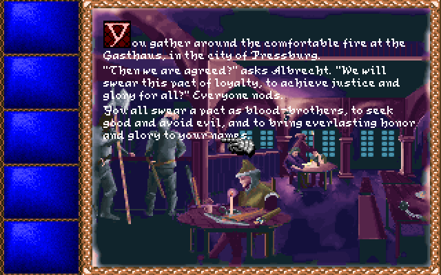 | 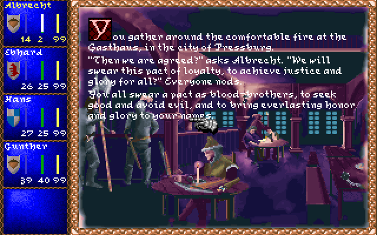 |
- **What an alchemist sells.** Alchemists sold only the first seven potions' formulas. Now formulas from the whole
  range, stronger potions and higher grades included. *How you notice it:* in an alchemist's list of formulas for sale.
  *Rules:* Fixed, Restored. *Since:* 1.2.0. *Register:* [B-10641a](faithfulness/ORIGINAL_BUGS.md).
- **What a battle sets, ends.** A saint's help or a price set during a battle was lost from the game's timetable after
  the battle, so it lasted for good. Now it ends when it should. *How you notice it:* on the character sheet a day after
  the battle. *Rules:* Fixed, Restored. *Since:* 1.2.0. *Register:* [B-e1b48f](faithfulness/ORIGINAL_BUGS.md).
- **A boost gives back what it added.** A temporary attribute boost that met the maximum, or overlapped another, could
  leave the attribute lower than before when it ended. Now it gives back exactly what it added. *How you notice it:* on
  the character sheet when the boost ends. *Rules:* Fixed, Restored. *Since:* 1.2.0. *Register:*
  [B-6eb045](faithfulness/ORIGINAL_BUGS.md).
- **Friendship with a Hussite band.** Claiming friendship with a Hussite band succeeded only when the roll equalled the
  chance shown. Now at that chance. *How you notice it:* meeting a Hussite band: the claim works as often as its chance
  says. *Rules:* Fixed, Restored. *Since:* 1.2.0. *Register:* [B-7bfead](faithfulness/ORIGINAL_BUGS.md).
- **A rope in the peat bog.** In the peat bog, throwing a rope asked for a polearm, a bow or metal armour instead of a
  rope. Now a rope. *How you notice it:* in the peat bog with a rope in a pack: the line can be chosen. *Rules:* Fixed,
  Restored. *Since:* 1.2.0. *Register:* [B-03246c](faithfulness/ORIGINAL_BUGS.md).
- **The bankers' and the Hanse's standing survives a saved game.** The party's standing with the Fugger, the Medici and
  the Hanse (St. Matthew raises the bankers') was lost when a game was loaded: the original keeps it nowhere in
  the saved game, so a load brought back the standing of the game played before (or none). Now it is kept in spare bytes of
  the save's header. *How you notice it:* at a Fugger or Medici bank, or at the Hanse's hall, after loading a game: they
  treat the party as before the save. The 1992 game loads such a save, but clears the standings if it saves it again.
  *Rules:* Fixed, Restored. *Since:* 1.2.0. *Register:* [B-047d71](faithfulness/ORIGINAL_BUGS.md).

  For example, in Lübeck's Marktplatz, at the Fugger banking offices: Ebhard prays to St. Matthew and the chance of a
  letter of credit rises from 79% to 99% (Basic difficulty, Shift held over the line). The game is saved there, the game
  quit and started again, and the save loaded:

  | After the prayer | Loaded, before (Original) | Loaded, now (Fixed) |
  |---|---|---|
  |  |  |  |
- **The potion thrown at footpads.** In a city street, the potion that scattered the footpads stayed in the pack, ready
  for the next ambush. Now it is used up, as the card says (the bottle bursts). *How you notice it:* in the
  thrower's pack afterwards. *Rules:* Fixed, Restored. *Since:* 1.2.0. *Register:* [B-556a53](faithfulness/ORIGINAL_BUGS.md).

  | Before (the 1992 game): the Noxious Aroma still in Albrecht's pack | Now: used up |
  |---|---|
  | 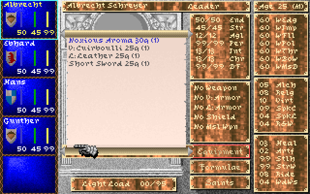 | 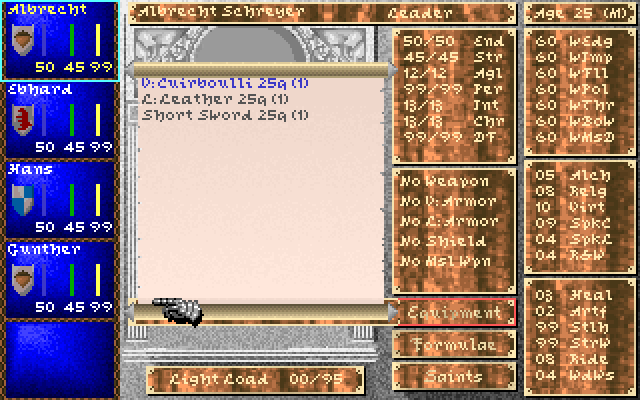 |
- **Climbing a city's walls by night.** Outside a city's walls at night, the grapple (one climber throws down a rope) had
  no chance at all, and everybody climbing on his own always got over, whoever was in the party. Now, as by day, the
  grapple's chance is the best climber's and everybody climbing is as hard as for the weakest climber. *How you notice
  it:* the chances the two lines show. *Rules:* Fixed, Restored. *Since:* 1.2.0. *Register:*
  [B-79145e](faithfulness/ORIGINAL_BUGS.md), [B-edab45](faithfulness/ORIGINAL_BUGS.md).

  | | Before (the 1992 game) | Now |
  |---|---|---|
  | The grapple | 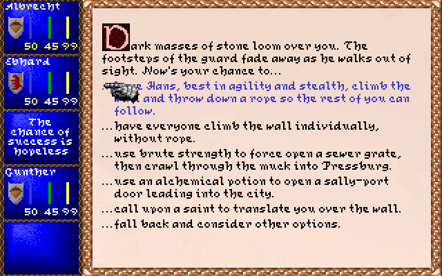 | 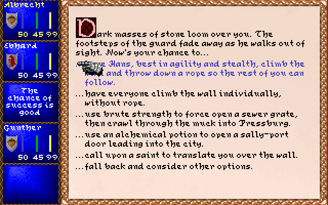 |
  | Everybody climbs |  | 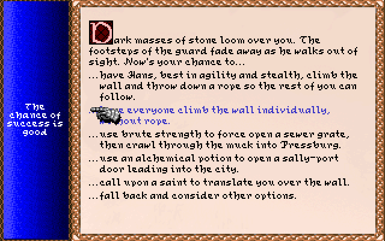 |

## Potions and saints

What the potions and the saints give now lasts about a day, as the game's own texts say (the manual, the saints'
descriptions, the clue book), instead of for good; a new dose or prayer of the same kind replaces the one running. A potion or
charm already in a saved game from before stays as it was. *How you notice it:* none of this shows on a screen: in fights,
by the harm done and taken, and after about a day, when the effect is gone. *Rules:* Fixed, Restored. *Since:* 1.2.0.

- **Deadly Blade, Strongedge and Great Power** lasted for good and added up with every dose. Now each lasts about a day, a
  new dose replaces the old one, and each works with the weapons the manual names: Deadly Blade with every weapon but
  impact weapons and flails, Strongedge with edged weapons and polearms, Great Power with impact weapons, flails and
  handguns; with another weapon it does nothing. *Register:* [B-11a75a](faithfulness/ORIGINAL_BUGS.md).
- **Great Power** scrambled the weapon's damage and penetration (a weapon could come out worse: "after Great Power my bows
  only do 3-5 damage"). Now it does what the manual says: the weapon's quality is 14, 22 or 30 points better (by the
  potion's quality), up to 99, for about a day, with impact weapons, flails and handguns. *Register:*
  [B-555b7a](faithfulness/ORIGINAL_BUGS.md).
- **Hardarmor and Firewall** lasted for good, and Firewall added armour against every blow. Now each lasts about a day, and
  Firewall guards against flame only (Arabian Fire, a dragon's breath), as the clue book says. *Register:* [B-d0b264](faithfulness/ORIGINAL_BUGS.md).
- **St. Polycarp** gave a lasting charm (armour against every blow) instead of his protection from fire. Now: fire
  protection 90 for the whole party, about a day. *Register:* [B-44772a](faithfulness/ORIGINAL_BUGS.md).
- **St. Charity** gave a lasting charm instead of resistance to fire. Now: fire protection 90 for the one prayed for and 50
  for the others, about a day. *Register:* [B-315695](faithfulness/ORIGINAL_BUGS.md).
- **St. Erasmus** gave a lasting charm instead of resistance to fire. Now: fire protection 50 for the party, about a day.
  *Register:* [B-f32e0e](faithfulness/ORIGINAL_BUGS.md).
- **St. Pantaleon** gave a lasting charm instead of what his text says. Now: fire protection 30 for the party and less
  harm from wolves, boars, bears and spiders (+1 armour against them), about a day. *Register:* [B-ce6144](faithfulness/ORIGINAL_BUGS.md).
- **St. Patrick** added armour against every blow, for good. Now: +2 armour against missiles for the one prayed for, about a
  day. *Register:* [B-a19878](faithfulness/ORIGINAL_BUGS.md).
- **St. Dunstan** added armour against every blow, for good. Now, as his text says, the party's metal armour (scale,
  chainmail, brigandine, plate) is 20 points better for about a day; enemies are not affected. *Register:* [B-243faa](faithfulness/ORIGINAL_BUGS.md).
- **St. Michael** did not improve the party's weapons and armour, as his text says he does. Now, besides his other gifts,
  every member's weapons and armour are 20 points better in a fight for about a day (up to 99). *Register:*
  [B-723764](faithfulness/ORIGINAL_BUGS.md).

The fixes below show on the character sheet. *Rules:* Fixed, Restored. *Since:* 1.2.0. What the saints the Fixed rules change
give, the gifts their texts do not mention included: [SAINTS.md](SAINTS.md).

- **Healing does not undo a boost.** Healing (Essence of Grace, a saint) pulled an attribute that a boost had lifted above
  its maximum back down, and the boost then cost it again when it wore off. Now healing restores only what is lost, as the
  clue book says, and never goes past the maximum. *How you notice it:* drink Ironarm, then Essence of Grace: the Strength
  stays where Ironarm put it (the party panel's middle number). *Register:* [B-308359](faithfulness/ORIGINAL_BUGS.md).

  | Before (the 1992 game; 4x): Strength 51 | Now (4x): Strength 55 |
  |---|---|
  | 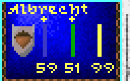 | 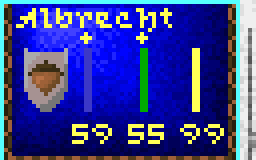 |
- **St. Dismas** helped the one member prayed for. Now, as his text says, the whole party's Agility, Woodwise and Stealth
  rise, and the one prayed for also gets Charisma and Speak Common. *How you notice it:* on another member's sheet after
  the prayer. *Register:* [B-5eb6aa](faithfulness/ORIGINAL_BUGS.md).

  | Before (the 1992 game): Ebhard's sheet after Albrecht's prayer | Now: Ebhard's Agility and Woodwise risen |
  |---|---|
  | 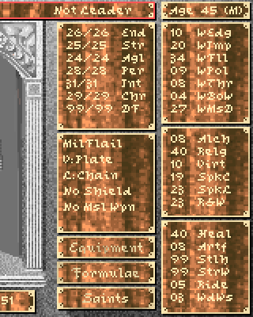 |  |
- **St. Christopher** neither sped the party's travel nor healed. Now he heals a little Strength (a fifth of what is lost)
  and Endurance (three tenths), and for a week the party travels overland half again as fast (a step takes two thirds of
  its time; encounters come per step as before). *How you notice it:* on the sheet after the prayer, and on the clock
  while travelling. *Register:* [B-623452](faithfulness/ORIGINAL_BUGS.md).

  | Before (the 1992 game): Strength 2 of 17 | Now: Strength 5 of 17 |
  |---|---|
  | 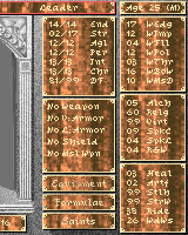 |  |
- **St. Anthony** lifted Strength and Endurance above their maximum for a day and took it back afterwards (a member could
  end lower than before). Now, as his text says (for these two, healing only), they are healed by the same amounts, up to the maximum,
  and nothing is taken back. *How you notice it:* on the sheet after the prayer. *Register:*
  [B-747355](faithfulness/ORIGINAL_BUGS.md).

  | Before (the 1992 game): Endurance 18 of 14, Strength 26 of 17 | Now: 14 of 14, 17 of 17 |
  |---|---|
  | 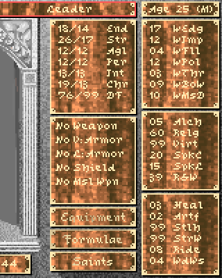 |  |
- **St. Thomas Aquinas** gave no Religion, though his text promises a large increase. Now his other gifts stay and
  Religion rises by 20 to 39 for about a day; and where the city has a monastery or a university, the party's standing
  there rises, as his text says. *How you notice it:* Religion on the sheet after the prayer. *Register:*
  [B-78a26c](faithfulness/ORIGINAL_BUGS.md).

  | Before (the 1992 game): Religion 60 | Now: Religion 95 |
  |---|---|
  |  |  |

## Camp

- **Stopping a brew gives back its ingredients.** Stopping a brew gave back empty stacks for the formula's unused
  ingredient slots. Now only the ingredients. *How you notice it:* in the alchemist's pack after a brew is stopped.
  *Rules:* Fixed, Restored. *Since:* 1.2.0. *Register:* [B-9d2829](faithfulness/ORIGINAL_BUGS.md),
  [B-9d82a1](faithfulness/ORIGINAL_BUGS.md).
- **Stopping a brew finds every brew.** Stopping a brew could miss some of the member's brews. Now it finds every one.
  *How you notice it:* at camp: no brew goes on after it was stopped. *Rules:* Fixed, Restored. *Since:* 1.2.0.
  *Register:* [B-9d2829](faithfulness/ORIGINAL_BUGS.md), [B-9d82a1](faithfulness/ORIGINAL_BUGS.md).
- **The teacher list at an inn.** At an inn, the teacher list counted the teachers of other towns, leaving some out and
  sometimes picking another town's. Now it shows every teacher of the town, each row that teacher. *How you notice it:*
  in the inn's list of teachers. *Rules:* Fixed, Restored. *Since:* 1.2.0. *Register:*
  [B-459e15](faithfulness/ORIGINAL_BUGS.md).
- **Leaving a stay by an empty row.** Leaving a stay by clicking an empty party row left Save and Load off until another
  screen, kept the music off and unfinished brews going. Now it ends the stay as the other ways do. *How you notice it:*
  in the Game menu after such a stay: Save and Load can be chosen. *Rules:* Fixed, Restored. *Since:* 1.2.0. *Register:*
  [B-2a4a58](faithfulness/ORIGINAL_BUGS.md).

## Battles

- **An empty enemy group.** An empty enemy group took every later group with it. Now the other groups still come. *How
  you notice it:* in such a battle: all the enemies it should have. *Rules:* Fixed, Restored. *Since:* 1.2.0.
  *Register:* [B-a044f7](faithfulness/ORIGINAL_BUGS.md).
- **A cloud that has gone.** A cloud that had gone still blocked shots. Now only the clouds there are. *How you notice
  it:* in a battle with clouds: shots pass where a cloud was. *Rules:* Fixed, Restored. *Since:* 1.2.0. *Register:*
  [B-3cc78a](faithfulness/ORIGINAL_BUGS.md), [B-bfb04e](faithfulness/ORIGINAL_BUGS.md).
- **D on the loot screen.** On the loot screen after a battle, D skipped another member instead of the one who left by
  the stairs. Now the one who left. *How you notice it:* on the loot screen, pressing D. *Rules:* Fixed, Restored.
  *Since:* 1.2.0. *Register:* [B-dd3d33](faithfulness/ORIGINAL_BUGS.md).
- **Esc with nobody selected.** Esc in order mode with nobody selected left the battle half-paused. Now nothing changes.
  *How you notice it:* in a battle: it goes on as before the key. *Rules:* Fixed, Restored. *Since:* 1.2.0. *Register:*
  [B-dce381](faithfulness/ORIGINAL_BUGS.md), [B-8f3e7c](faithfulness/ORIGINAL_BUGS.md),
  [B-2eb386](faithfulness/ORIGINAL_BUGS.md).
- **Enter with nobody selected.** Enter (travel individually) with nobody selected gave an order to nobody and changed
  stray values. Now nothing changes. *How you notice it:* behind the scenes. *Rules:* Fixed, Restored. *Since:* 1.2.0.
  *Register:* [B-8d32e1](faithfulness/ORIGINAL_BUGS.md).
- **U with nobody selected.** U with nobody selected and the party split changed a stray value. Now nothing changes.
  *How you notice it:* behind the scenes (nothing visible read it). *Rules:* Fixed, Restored. *Since:* 1.2.0.
  *Register:* [B-afe397](faithfulness/ORIGINAL_BUGS.md).
- **The stairs' mark on a wall.** The mark the stairs leave on a wall group was lost when the level was left, so the
  wall opened again. Now it is kept. *How you notice it:* on returning to that level: the wall stays as it was left.
  *Rules:* Fixed, Restored. *Since:* 1.2.0. *Register:* [B-e7ca8e](faithfulness/ORIGINAL_BUGS.md).
- **Dissolve Lock without the Eater-Water.** A Dissolve Lock order whose Eater-Water was moved away while it waited
  still opened the lock. Now it does not. *How you notice it:* in a battle, moving the potion away on the sheet before
  the order runs. *Rules:* Fixed, Restored. *Since:* 1.2.0. *Register:* [B-12142a](faithfulness/ORIGINAL_BUGS.md).

## In every rule set: where our game differed from the original

These are not changes to the 1992 game but places where our game did not do what the original program does. They are
fixed in every rule set, Original included, and checked against the original program itself (the register:
[faithfulness/SUMMARY.md](faithfulness/SUMMARY.md), the round named in each entry).

### The message box on the world map

**What was wrong:** when the party noticed a place on its way (a robber knight's territory, for one), the box with
the message drew its lines one pixel too close together, showed the pointer over the text, and the key that closed it was
used up: a party walking to a clicked point walked on after the box closed. **Now** the box looks as in the original (the
lines one pixel further apart, no pointer while it waits), and the key that closes it stops the walk, as in the original.

**How you notice it:** walk across the map (with the mouse) into the area of a place with a notice, for example the robber
knight's tower of Meissen, near Dresden. Before, the pointer covered a word of the message and, after Enter, the party
went on to the clicked point; now the box is as in the original and the party stops where it is.

| Before (1.1.5 and earlier) | Now (the same as the original, pixel for pixel) |
|---|---|
|  |  |
| 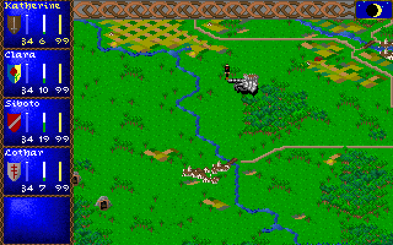 |  |

In every rule set (Original, Fixed, Restored). Since 1.2.0; wrong since 0.9.0. Register: faithfulness round loadact1
(the recorded session `lta-robber-cairn` checks it against the original).

### Groningen after a game loaded in the wilderness

**What was wrong:** a game saved on the world map and loaded again, then taken straight to Groningen, showed the city wrong:
a stray `Ö` before its name, no Stadtplatz and no Markt on the main street, the inn's name missing, a city lord's title left
as `CityLordTitle`, and the city's own numbers (the toll at the gate, for one) read from the wrong place. Any other city, and
Groningen reached after another city, were always right. **Now** the game reads Groningen's own record on arrival, as the
original does.

**How you notice it:** load a game saved on the map, travel straight to Groningen and read its arrival and main street.
Your saved games are fine: a game saved in Groningen while it showed wrong is right once loaded.

| Before (1.1.4 and earlier) | Now (the same as the original) |
|---|---|
|  | 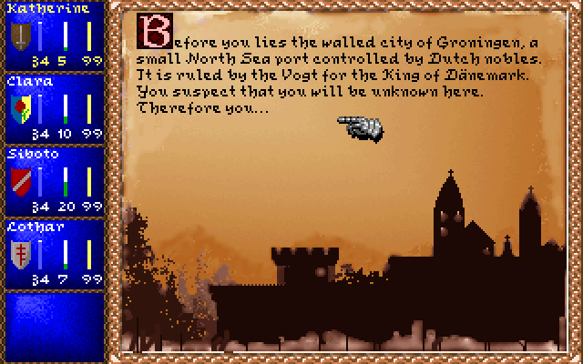 |
| 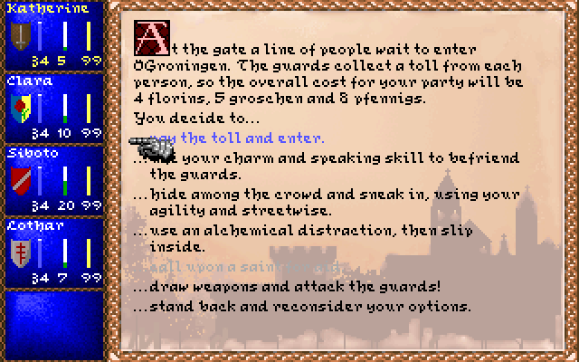 | 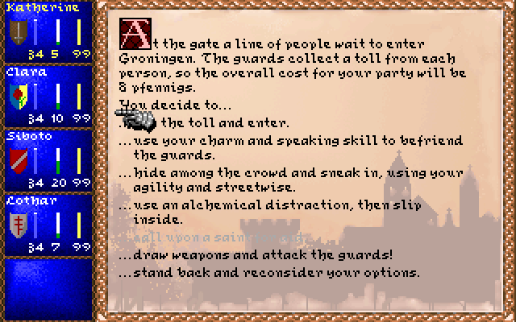 |

In every rule set (Original, Fixed, Restored). Since 1.1.5; wrong since 0.9.0 (GitHub issue 7). Register: faithfulness round
issue7 (the recorded session `wild-load-groningen` checks it against the original).

### The citadel's courtyard after one of its trials

**What was wrong:** coming back to the courtyard of Baphomet's citadel from one of its rooms, our game built the courtyard
fresh and made the party fight its guards again, and the rooms already finished were not marked. **Now** the party starts at
that room's door with the courtyard empty, and the finished rooms have their doors marked, as in the original.

**How you notice it:** at the end of the game, in the citadel: after a trial, back in the courtyard, nobody attacks.

In every rule set (Original, Fixed, Restored). Since 1.2.0; wrong since 1.0.0. Register: faithfulness round court-progress
(the recorded sessions `court-return` and `court-gate` check it against the original).

## In every rule set: our own HD fonts and language packs

Glitches of features added in 1.1 (the HD fonts, the language packs), not of the 1992 game. Without a font pack or a
language pack none of them showed.

- **No faint outlines of hidden answers** (HD fonts). On cards whose answers appear only after a key (the raubritter's
  audience, for one), faint outlines of the hidden answers showed over the picture before the key. *How you notice it:*
  such a card with the HD fonts. *Since:* 1.1.1.
- **No thin bits of the original letters beside the HD letters.** Thin dark or light ticks of the low-resolution letters
  showed beside the HD letters when the picture was not a whole multiple of its size in the window (most full screens and
  window sizes) with a filter other than Sharp. *How you notice it:* the saved-games list, the party panel, card texts. *Since:*
  1.1.2.
- **Data files' descriptions and the alchemy and camp texts in a language pack.** A saint's, a formula's and a city's
  description kept the English whatever a pack said, and the alchemy and camp screens drew a pack's non-Latin letters as `?`.
  *How you notice it:* those screens with a language pack. *Since:* 1.1.3.
- **The pointer over HD text.** With the HD fonts, the pointer moved over a card's text showed under the letters, and the
  letters next to it went missing. Now it is drawn over the text. *How you notice it:* the pointer over a card's lines.
  *Since:* 1.1.4.

  | Before (1.1.3, HD fonts) | Now (HD fonts) |
  |---|---|
  |  |  |

- **Another screen's text over a card.** Coming back to a card from a store or another screen, faint pieces of that screen's
  lines showed over the card's picture with the HD fonts. *How you notice it:* back on a card from the market's merchants.
  *Since:* 1.1.4.

## In every rule set: saved games and the program

Bugs of the 1992 game that damage saved games, lose items or end the program. They are fixed in every rule set,
Original included; the testers' exact mode alone keeps them.

- **Item stores and the stores' file.** Leaving an item store with a list wrote the stores' file wrongly and garbled the
  other stores. Now it is written whole. *How you notice it:* items left at inns and places are where they were left.
  *Rules:* Original, Fixed, Restored. *Since:* 0.9.2. *Register:* [B-3de49c](faithfulness/ORIGINAL_BUGS.md),
  [B-85e0e4](faithfulness/ORIGINAL_BUGS.md), [B-cf6bdb](faithfulness/ORIGINAL_BUGS.md).
- **Many item stores.** The 99th item store overwrote the first. Now at most 62 stores are kept, and a store that needs
  more is refused. *How you notice it:* items left at many places stay where they were left. *Rules:* Original, Fixed,
  Restored. *Since:* 0.9.2. *Register:* [B-3de49c](faithfulness/ORIGINAL_BUGS.md),
  [B-85e0e4](faithfulness/ORIGINAL_BUGS.md), [B-cf6bdb](faithfulness/ORIGINAL_BUGS.md).
- **A party with an empty slot, saved.** A saved game of a party with an empty slot was written short. Now every record
  is written. *How you notice it:* the saved game loads whole. *Rules:* Original, Fixed, Restored. *Since:* 0.9.2.
  *Register:* [B-1cec30](faithfulness/ORIGINAL_BUGS.md), [B-0c7843](faithfulness/ORIGINAL_BUGS.md).
- **A member who leaves and rejoins.** A member leaving the party kept only part of the record: saints, formulas and
  items were old on rejoining. Now the whole record. *How you notice it:* a member left at an inn comes back with what
  he had. *Rules:* Original, Fixed, Restored. *Since:* 0.9.5. *Register:* [B-c48d94](faithfulness/ORIGINAL_BUGS.md).
- **A damaged saved game.** A damaged (cut short) saved game loaded as garbage or ended the program. Now the load is
  refused with a notice, and nothing changes. *How you notice it:* a notice instead of a broken game. *Rules:* Original,
  Fixed, Restored. *Since:* 1.0.0. *Register:* [B-e60d2a](faithfulness/ORIGINAL_BUGS.md).
- **A saved game with impossible values.** A saved game with impossible values (a month, day, hour or place that cannot
  be) read past the game's tables. Now the load is refused with a notice. *How you notice it:* a notice instead of a
  broken game. *Rules:* Original, Fixed, Restored. *Since:* 1.0.0. *Register:*
  [B-e60d2a](faithfulness/ORIGINAL_BUGS.md), [B-f523d4](faithfulness/ORIGINAL_BUGS.md).
- **Two party slots for one character.** A saved game with two party slots naming one character ended the program on the
  load screen. Now the second slot stays empty. *How you notice it:* such a save loads. *Rules:* Original, Fixed,
  Restored. *Since:* 1.0.0. *Register:* [B-7c20ca](faithfulness/ORIGINAL_BUGS.md).
- **Alt-Q on the map, answered no.** Alt-Q on the travel map, answered no, damaged the map's memory, so the program
  could end later. Now nothing is lost. *How you notice it:* behind the scenes: the program goes on. *Rules:* Original,
  Fixed, Restored. *Since:* 1.0.0. *Register:* [B-983895](faithfulness/ORIGINAL_BUGS.md).
- **The inn roster's figure list.** In the inn roster, an arrow onto a row past the figure list ended the program. Now
  nothing is drawn there. *How you notice it:* in the roster, pressing the arrows over the last rows. *Rules:* Original,
  Fixed, Restored. *Since:* 1.0.0. *Register:* [B-0fd1d5](faithfulness/ORIGINAL_BUGS.md).
- **The inn roster's colour keys.** In the inn roster, the colour keys could change another member's colours. Now the
  row's own character. *How you notice it:* in the roster: the colours change on the character chosen. *Rules:*
  Original, Fixed, Restored. *Since:* 1.0.0. *Register:* [B-9db08d](faithfulness/ORIGINAL_BUGS.md).
- **Heraldry and image on an empty roster row.** In the inn roster, Heraldry and Select Image on a row with no character
  changed an earlier character's shield or figure. Now nobody's. *How you notice it:* in the roster: the other
  characters keep their shields and figures. *Rules:* Original, Fixed, Restored. *Since:* 1.0.0. *Register:*
  [B-1d4d7c](faithfulness/ORIGINAL_BUGS.md).

  | Before (the 1992 game) | Now |
  |---|---|
  | 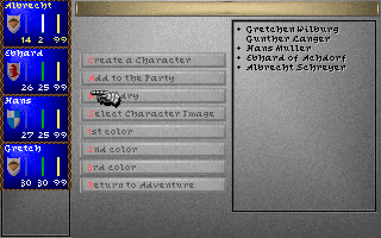 | 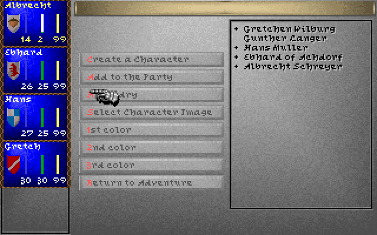 |
- **A ghost member after the Devil's Bridge.** The Devil's Bridge crossing could leave a just-emptied party slot able
  with no character (a ghost member in the saved game). Now the slot stays empty. *How you notice it:* the party panel
  after the crossing. *Rules:* Original, Fixed, Restored. *Since:* 0.9.6. *Register:*
  [B-ad9d9e](faithfulness/ORIGINAL_BUGS.md).
- **Dissolve Lock uses up an Eater-Water.** Dissolve Lock could use up another stack of the pack, or a stack past the
  last. Now only an Eater-Water, the weakest one. *How you notice it:* in the member's pack after the lock opens.
  *Rules:* Original, Fixed, Restored. *Since:* 0.9.5. *Register:* [B-dce22a](faithfulness/ORIGINAL_BUGS.md),
  [B-bf6904](faithfulness/ORIGINAL_BUGS.md).
- **The D key outside order mode.** The D key outside order mode used up a stack of the selected member, or stray
  memory. Now the leader's Eater-Water. *How you notice it:* in the leader's pack. *Rules:* Original, Fixed, Restored.
  *Since:* 0.9.5. *Register:* [B-d71b85](faithfulness/ORIGINAL_BUGS.md).
- **A lone member's Use Stairs.** With the party on two levels, a lone member's Use Stairs read his stairs from the
  level shown, not his own. Now his own. *How you notice it:* in a split battle: he takes the stairs he stands on.
  *Rules:* Original, Fixed, Restored. *Since:* 1.0.0. *Register:* [B-bdd7dd](faithfulness/ORIGINAL_BUGS.md).
- **The leader's U on another level.** The leader's U read his stairs from the level shown. Now from his own level. *How
  you notice it:* in a split battle: he takes the stairs he stands on. *Rules:* Original, Fixed, Restored. *Since:*
  1.0.0. *Register:* [B-afe397](faithfulness/ORIGINAL_BUGS.md), [B-cbc59a](faithfulness/ORIGINAL_BUGS.md).
- **A member gone through an exit.** A member who left through an exit made the others, on another level, count as fled
  and Away. Now they stay. *How you notice it:* the party panel after such a battle. *Rules:* Original, Fixed, Restored.
  *Since:* 1.0.0. *Register:* [B-9d748e](faithfulness/ORIGINAL_BUGS.md), [B-e7ca8e](faithfulness/ORIGINAL_BUGS.md),
  [B-d4d9e6](faithfulness/ORIGINAL_BUGS.md).
- **Doors, chests and locks on another level.** A member's door, chest and lock actions on another level acted on the
  level shown. Now on his own. *How you notice it:* in a split battle: the door or chest he stands at. *Rules:*
  Original, Fixed, Restored. *Since:* 1.0.0. *Register:* [B-25f2a4](faithfulness/ORIGINAL_BUGS.md),
  [B-55c416](faithfulness/ORIGINAL_BUGS.md).
- **Traps and alarms of another level.** Traps, alarms and secret doors of the level shown were set off by fighters on
  other levels. Now only by those on it. *How you notice it:* in a split battle. *Rules:* Original, Fixed, Restored.
  *Since:* 1.0.0. *Register:* [B-3f56bf](faithfulness/ORIGINAL_BUGS.md).
- **A fallen fighter's pack.** The pack of a fighter who fell on another level landed on the level shown. Now on his
  own. *How you notice it:* in a split battle: the pile lies where he fell. *Rules:* Original, Fixed, Restored. *Since:*
  1.0.0. *Register:* [B-fd2ef4](faithfulness/ORIGINAL_BUGS.md).
- **The way back up the stairs.** The record of the stairs back was written after the level changed (the wrong level, or
  never). Now it is right. *How you notice it:* in a split battle: the stairs back lead where they should. *Rules:*
  Original, Fixed, Restored. *Since:* 1.0.0. *Register:* [B-5e9887](faithfulness/ORIGINAL_BUGS.md).
- **Followers arrive on the party's level.** Followers arrived on the level shown, which could turn a member left behind
  Away. Now on the party's level. *How you notice it:* in a split battle. *Rules:* Original, Fixed, Restored. *Since:*
  1.0.0. *Register:* [B-e9dc75](faithfulness/ORIGINAL_BUGS.md).
- **The woken on another level.** The woken were placed with the walls of the level shown, so they could land in a wall.
  Now on their own level. *How you notice it:* in a split battle. *Rules:* Original, Fixed, Restored. *Since:* 1.0.0.
  *Register:* [B-fd4e71](faithfulness/ORIGINAL_BUGS.md).
- **The leader's keys on another level.** The leader's U, O, P and D acted through the level shown, at a distance or on
  the wrong stairs. Now they do nothing there. *How you notice it:* in a split battle. *Rules:* Original, Fixed,
  Restored. *Since:* 1.0.0. *Register:* [B-afe397](faithfulness/ORIGINAL_BUGS.md),
  [B-cbc59a](faithfulness/ORIGINAL_BUGS.md), [B-b02169](faithfulness/ORIGINAL_BUGS.md),
  [B-2a15e1](faithfulness/ORIGINAL_BUGS.md).
- **Arriving by stairs with no room.** When no place around the arrival was free, a member kept his old coordinates and
  could stand in the void. Now he arrives on a free place. *How you notice it:* in a crowded battle on stairs. *Rules:*
  Original, Fixed, Restored. *Since:* 1.0.0. *Register:* [B-e7ca8e](faithfulness/ORIGINAL_BUGS.md),
  [B-d4d9e6](faithfulness/ORIGINAL_BUGS.md), [B-fcc034](faithfulness/ORIGINAL_BUGS.md).
- **A battle taken up again from a save.** A battle loaded from a saved game put every member on the level shown. Now
  each on his own level. *How you notice it:* loading a game saved in a split battle. *Rules:* Original, Fixed,
  Restored. *Since:* 1.0.0. *Register:* [B-b189d0](faithfulness/ORIGINAL_BUGS.md).
- **Fighting across levels.** Enemy sight, missiles and effects used the level shown, so hits and targets crossed
  levels. Now everything stays on its own level. *How you notice it:* in a split battle. *Rules:* Original, Fixed,
  Restored. *Since:* 1.0.0. *Register:* [B-71d98a](faithfulness/ORIGINAL_BUGS.md),
  [B-de34f4](faithfulness/ORIGINAL_BUGS.md), [B-a3cd1d](faithfulness/ORIGINAL_BUGS.md).
- **Walking on a hidden level.** A fighter on a level not shown was stopped by the shown level's walls. Now by his own.
  *How you notice it:* in a split battle. *Rules:* Original, Fixed, Restored. *Since:* 1.0.0. *Register:*
  [B-85e0a9](faithfulness/ORIGINAL_BUGS.md).

## In every rule set: plain display glitches

Drawing glitches of the 1992 game, fixed in every rule set, Original included; the testers' exact mode alone keeps them.

- **The inn roster's figure preview.** In the inn roster, the figure preview was drawn in the wrong place, over earlier
  ones and in the wrong colours. Now once, in its place, as the figure is. *How you notice it:* in the roster, moving
  through the figures. *Rules:* Original, Fixed, Restored. *Since:* 1.0.0. *Register:*
  [B-fd1853](faithfulness/ORIGINAL_BUGS.md).

  | Before (the 1992 game) | Now |
  |---|---|
  | 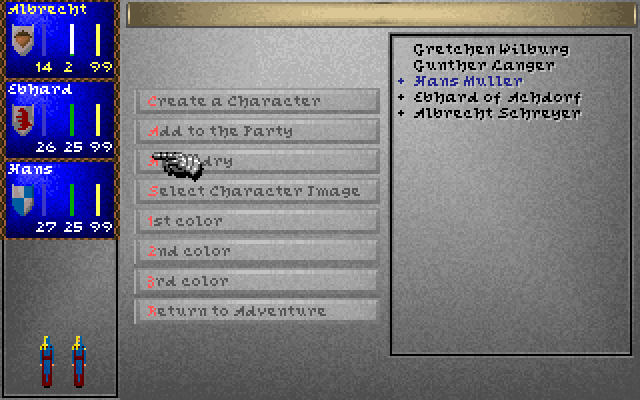 |  |
- **Party information in a battle.** The party information opened in a battle flashed with the battle's colour cycles.
  Now the colours hold still while it is open. *How you notice it:* opening the party information (the menu bar) during
  a battle. *Rules:* Original, Fixed, Restored. *Since:* 1.0.0. *Register:* [B-587744](faithfulness/ORIGINAL_BUGS.md).
- **The character sheet's skill values.** On the character sheet, the values of the skills from Healing down were 3
  pixels left of the other columns. Now in line (GitHub issue 4). *How you notice it:* on any character sheet. *Rules:*
  Original, Fixed, Restored. *Since:* 1.1.0. *Register:* [B-c26daf](faithfulness/ORIGINAL_BUGS.md).

  | Before (the 1992 game; 4x) | Now (4x) |
  |---|---|
  | 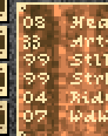 | 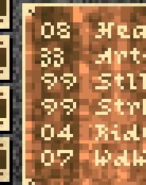 |
- **Finding towns on the party information's map.** On the party information's small map, the spot that named a town
  lay a few pixels off its dot: with the tip of the hand on the dot, 19 of the 92 towns, Erfurt and Wien among them,
  showed nothing or a neighbour. Now the town whose dot is under the tip of the hand is shown, for every town (GitHub
  issue 8). *How you notice it:* pointing at the towns on the map (F6). *Rules:* Original, Fixed, Restored. *Since:*
  1.2.0. *Register:* [B-63df1f](faithfulness/ORIGINAL_BUGS.md).

  | Before (the 1992 game; 3x) | Now (3x) |
  |---|---|
  | 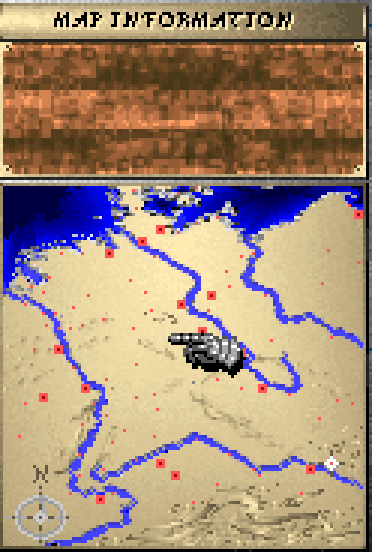 | 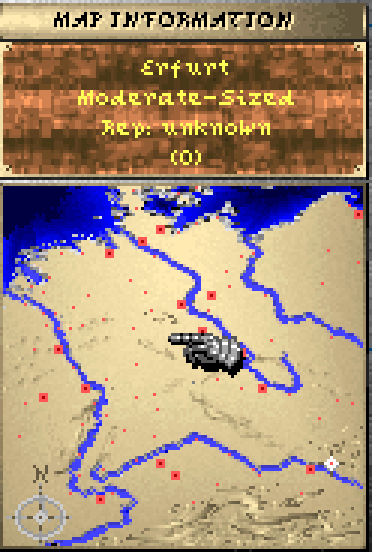 |
