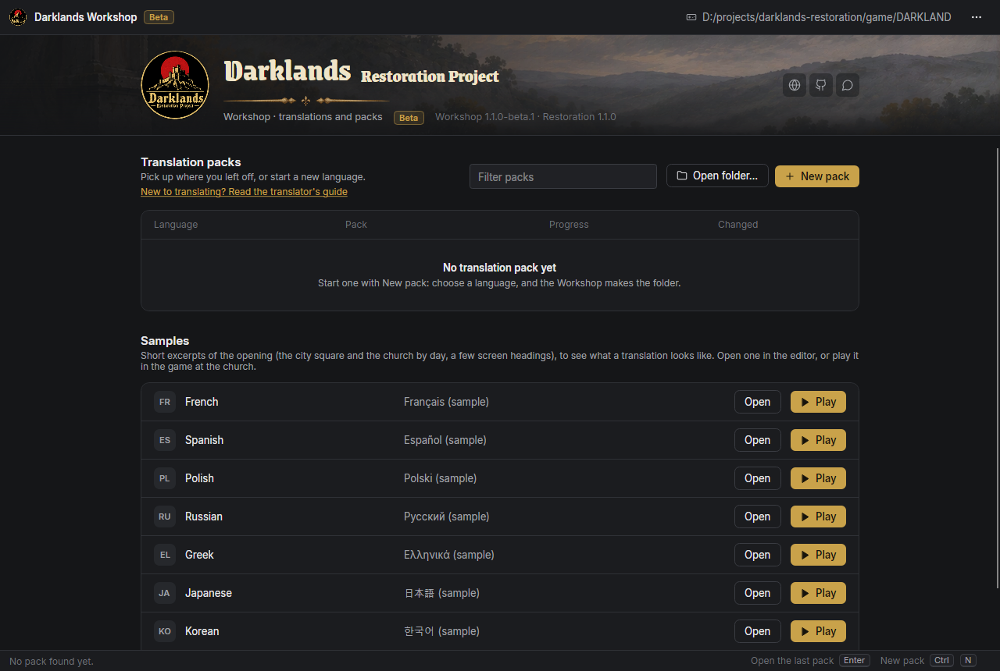
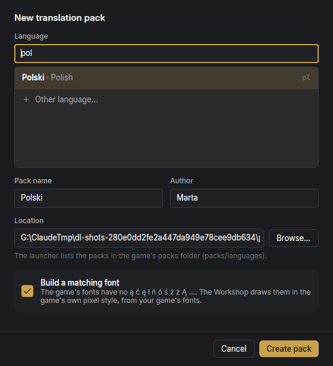
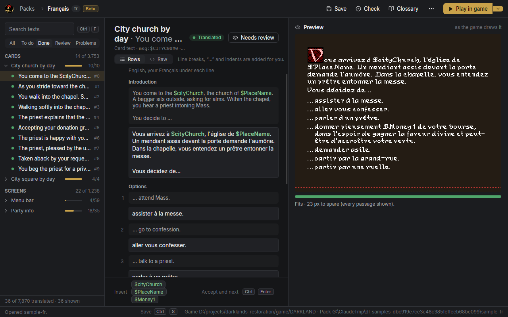
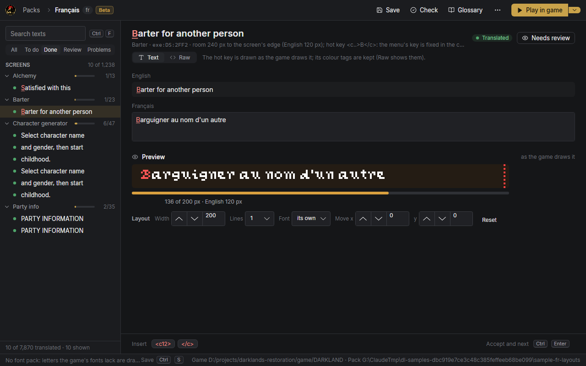
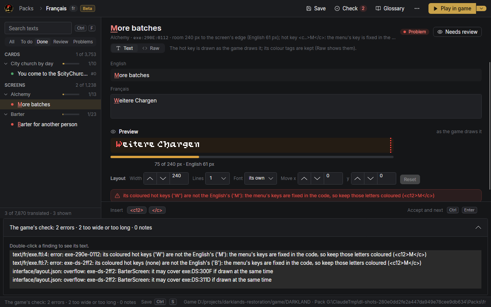
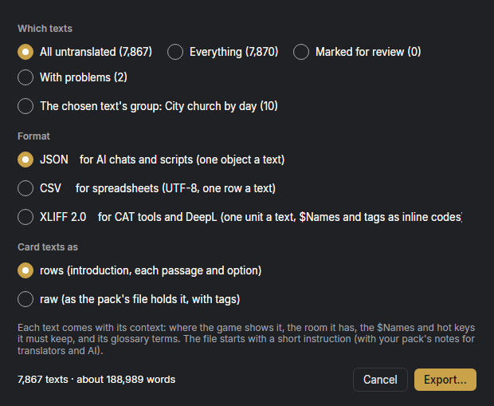

# Translating Darklands with the Workshop

This guide is for translators, not programmers. It takes you from nothing to a translation you can play and share. The
full reference, with every detail, is [LOCALISATION.md](LOCALISATION.md).

## What you need

* **Darklands itself**, the English version (GOG or Steam). Your translation is built on your own copy of the game: the
  Workshop reads the English from it, and nothing of the game comes with the Workshop.
* **The Darklands Restoration Project, 1.1 or later** (the `DarklandsRP` download): it plays your translation.
* **The Darklands Workshop** (its own download): the editor.

## Installing the Workshop

Unzip the Workshop's download into the `DarklandsRP` folder. It makes a `Workshop` folder there, holding
`DarklandsWorkshop`. Start it. The first time, it looks for your game as the launcher does; if it cannot find it, click
**Choose the game folder…** and pick the folder that holds `DARKLAND.EXE`.

If the game beside the Workshop is older than 1.1, the start page says so: download the newer game from the releases
page and unzip it over the old one (your saved games and settings stay).

## Opening a sample

The start page lists **Samples**: short excerpts of the opening (the city square and the church by day, and a few
screen headings) in French, Spanish, Polish, Russian and Greek, the church in Japanese and Korean, and a French sample of
screen layouts. They show what a finished translation looks like.

* **Open** opens one in the editor.
* **Play** starts the game with it, at the church.

When the sample's language has letters the game's fonts lack (é, ł, Greek or Cyrillic letters…), the Workshop offers
to build a matching font from your game's own fonts. Say yes: without it those letters show as `?`.

## Making your own pack

Click **New pack** (Ctrl+N). Choose your language from the list (type its name or its code), give the pack a name and
your name. The Workshop makes the pack in the game's `packs/languages` folder, where the game's launcher finds it. Leave
**Build a matching font** ticked when it is offered.

A pack is a plain folder: a `pack.json` naming it, and your texts in `.ftl` text files. You never need to edit them
by hand.

## Fonts for other alphabets

The game's fonts only have the English letters.

* **Latin, Greek and Cyrillic:** the Workshop builds pixel fonts in the game's own style, with your letters added
  (**… › Font pack…** at any time), into your pack's `fonts` folder. The game's **HD fonts** (TrueType, shipped with
  the game) also cover these alphabets.
* **Chinese, Japanese and Korean** need a TrueType font, such as Noto Sans CJK (free, SIL Open Font License), and the
  high-resolution display. The Japanese and Korean samples show how: the font sits in the pack's `fonts` folder and
  `fonts/slot1.json` to `slot3.json` name it.

## The editor

* **The list** on the left holds every text, grouped by card or screen ("City church by day", "Barter"). Filter it
  (**To do**, **Done**, **Review**, **Problems**) or search. A green dot is translated, an amber one marked for review,
  a red one has a problem, an empty ring is still to do.
* **Rows.** A card text opens in rows: the introduction, each passage and each option line in a field of its own, the
  English beside it. Write only the words: a new line is a line break, a blank line a new paragraph. The option markers
  and the "…" lead-ins are added for you. **Raw** shows the file's form, tags and all.
* **Chips** under your translation are the English's names and tags (`$PlaceName`, `$Money1`, a line break…). Click one,
  or press **Alt+1** to **Alt+9**, to put it where the cursor is. The editor tells you which ones you left out.
* **The preview** on the right draws your text as the game draws it, in the game's font, as you type.
* **The width bar** under a screen text says if it fits: green no wider than the English, amber wider but inside its
  box, red too wide.
* **Layout** (under a screen text's preview) gives a text that needs more room a wider box, a second or third line,
  another font or a small move. The French layouts sample shows it.

**Keys:** **Ctrl+Enter** accepts a text and goes to the next one to do; **Ctrl+↓** / **Ctrl+↑** the next and previous to
do; **F8** the next problem; **Ctrl+S** saves.

## Glossary and variables

* **Glossary** keeps the terms you agree on (a saint's name, "Kloster", "groschen"…). When a text's English holds one,
  it is listed above your translation, marked if your words do not use it.
* **Variables** holds your language's own little words that change with a character, such as "his" and "her". The
  game's names and numbers (`$PlaceName`, `$Money1`) are filled in when the game shows the text: keep them.

## Check

**Check** runs the game's own check on your whole pack: letters the font lacks, a lost `$Name`, a text past its box,
a changed hot-key letter. Its findings open under the editor; double-click one to go to its text. **F8** steps through
them.

## Play in game

**Play in game** saves and starts the game with your pack, **at the text you are on**: a quick-start party, at that
card's passage or with that screen open. The small arrow beside it has **From the start**. Your test games are saved
inside the pack's own `.workshop` folder, never with your real saved games.

Some texts cannot be reached this way (after a battle, deep in a story); the game then says so plainly and opens at the
nearest point. The preview always shows every text.

## Export, import and Copy for AI

* **… › Export texts…** writes texts to a file for another tool: JSON, a spreadsheet (CSV) or XLIFF (for CAT tools and
  DeepL). Each text comes with its context, its room and what it must keep.
* **… › Import texts…** reads such a file back. Every text it sets is marked for review, a text you already reviewed is
  never overwritten, and a summary lists what came in and what is too long or broken.
* **Copy for AI** puts the current card or screen on the clipboard as a request an AI chat understands. Paste the
  chat's answer back with **Paste result**: it goes through the same import and summary. The Workshop itself sends
  nothing anywhere.

## Sharing your pack

Zip the pack's folder **without** its `.workshop` folder (your test saves). Players unzip it into the game's
`packs/languages` folder and choose it in the launcher's **Language pack** row (Advanced tab). A pack without a font of
its own can be played with the game's **HD fonts** (the launcher's **Font pack** row), or its pixel font built from the
player's own game (the Workshop's **… › Font pack…**, or `DarklandsRP --make-font-pack <pack folder>`, with
`--scripts latin,cyrillic` or `--scripts latin,greek` for those alphabets).

A sample can be played the same way: copy its folder from `Workshop/examples/languages` into `packs/languages`.

Translations of the game's text are yours to host: the project does not distribute them (the samples are a few short
excerpts, to show the tool). Tell others on the Discord or in a GitHub issue for your language.

## Reporting a problem

**… › Report a problem…** makes a zip beside the program with what helps us (the Workshop's log, your pack's name and
version) and opens the report form on GitHub. Nothing is sent by itself: you attach the zip and describe what happened.

Questions are welcome on the Discord: <https://discord.gg/HjzWvmHhqZ>.
