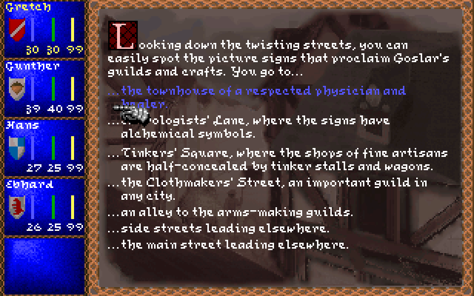
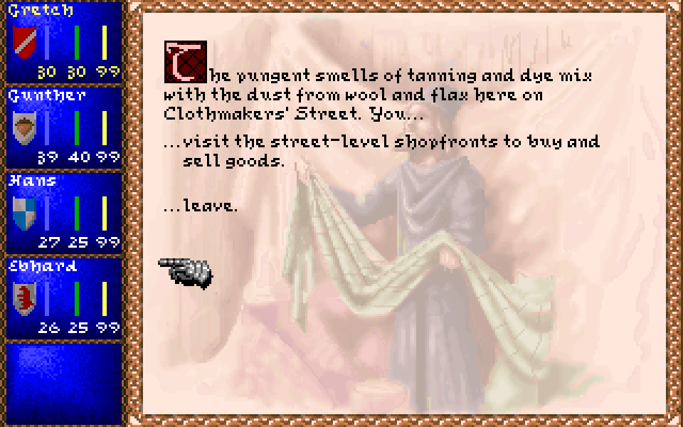
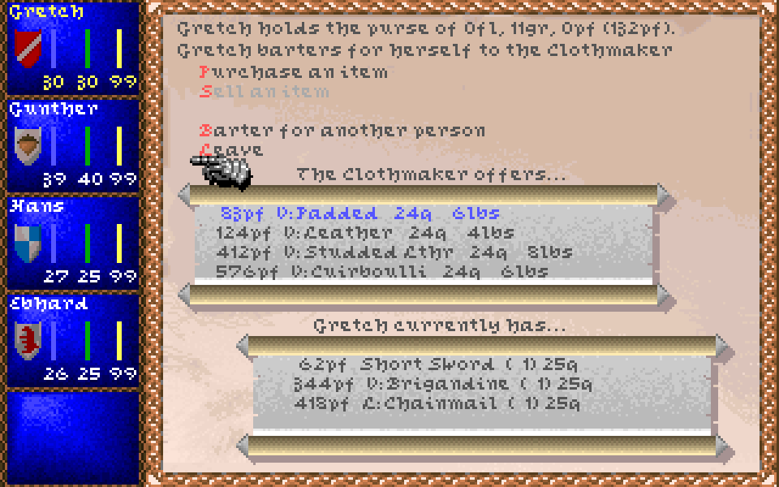
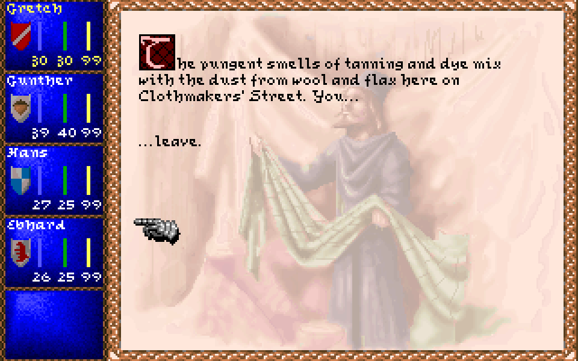

# The clothmakers' guild sells by day

**Restored only; Original and Fixed are unchanged.** [Back to the list of what Restored adds](../RESTORED.md)

## What it is

On Clothmakers' Street the guild sells its non-metal armour (padded, leather, studded leather, cuirbouilli). The 1992
game sells it only at night, to a party that wakes somebody up. By day the street's shop line, "...visit the
street-level shopfronts to buy and sell goods.", is in the game's files but never offered. Restored offers it by day.

## How to find it

- **Where:** any city. From the main street, choose "...the craft guilds and other, darker, side alleys.", then
  "...guilds and crafts who specialize in less violent pursuits.", then "...the Clothmakers' Street".
- **When:** by day, on every visit.
- **What the party needs:** money to buy, or goods the guild will take.

## What happens

The shop line opens the clothmakers' shop: the same screen and goods the woken guild offers at night. Shopping takes
an hour. The party then comes back to the street, where it can shop again or leave. The street's other lines (the
guild's politics, when the city has them) are unchanged.

## Screenshots

Taken in play: a Quick Start game in Goslar, by day, walking from the inn.

The crafts quarter, with the way to the Clothmakers' Street:

The Clothmakers' Street by day in Restored, with the shop line:

The clothmakers' shop:

**In Original** the street by day offers only "...leave.":

## Where it comes from

The day line, its text and its shop are in the game's files in every release; the shop works at night in every
release, and only the day line is switched off. Register row R-e0e0ff, in
[RESTORATION.md](../faithfulness/RESTORATION.md#in-the-restored-rule-set).

## Since

The first release that offers the Restored rules (planned for 1.2).
