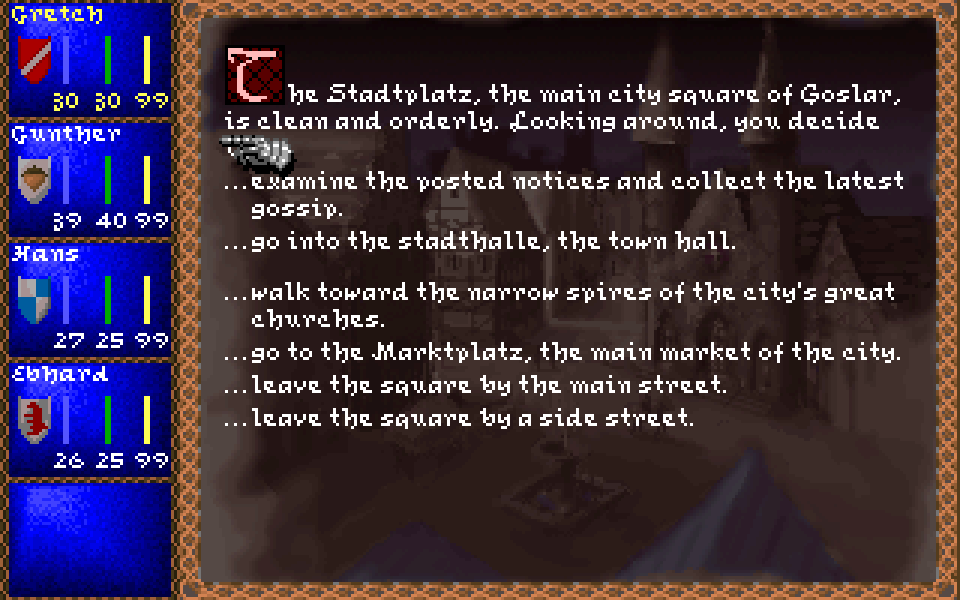
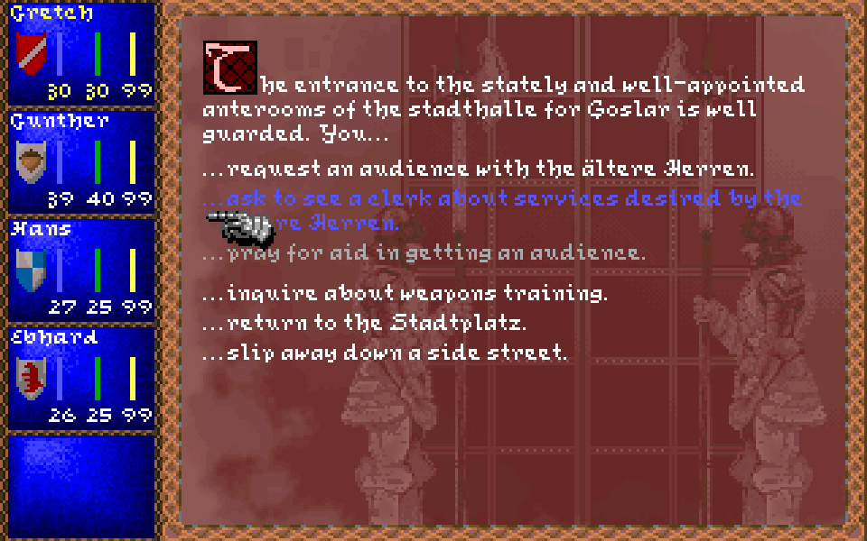
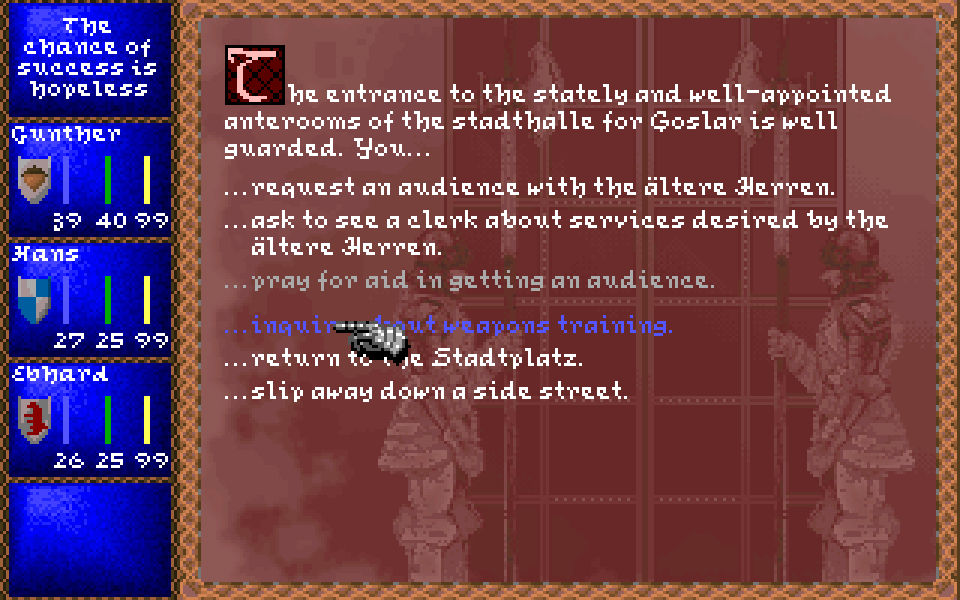
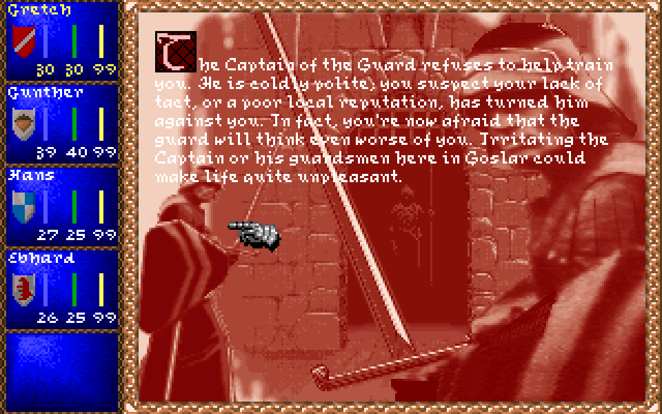
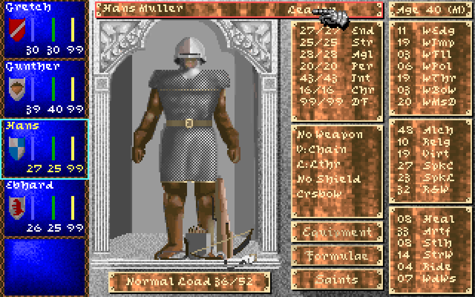
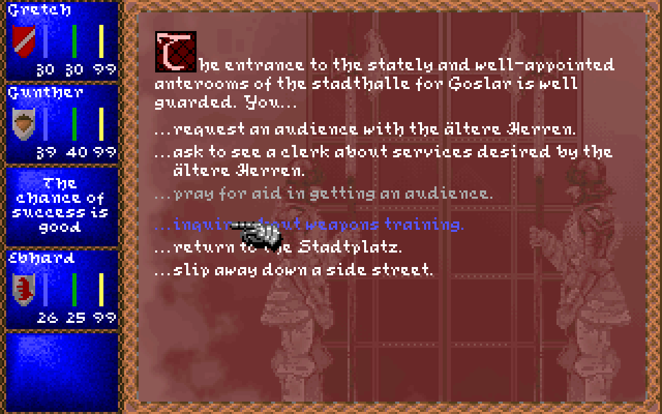
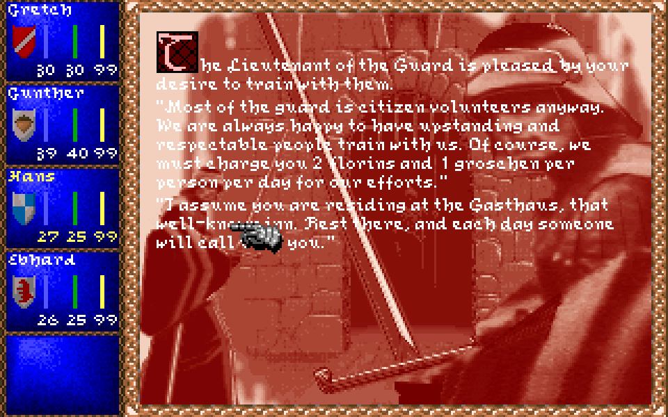
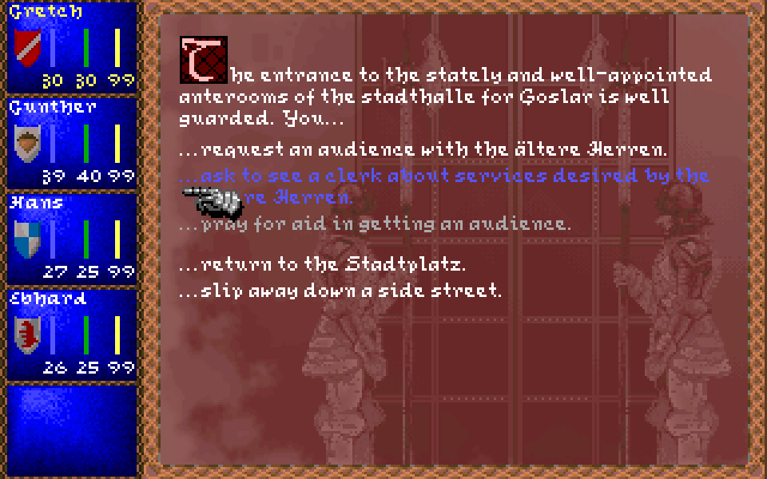

# Weapons training with the city guard

**Restored only; Original and Fixed are unchanged.** [Back to the list of what Restored adds](../RESTORED.md)

## What it is

In a city's town hall, the party can ask the Captain of the Guard to train its members in weapons. The 1992 game has
the line, its chance, both answers and the training offers, but never offers the line. Restored offers it.

## How to find it

- **Where:** any city. From the main square, choose "...go into the Stadthalle, the town hall." The town hall's list
  then includes "...inquire about weapons training."
- **When:** once a day. After the guard has been asked, the line stays greyed until the next day. It is also greyed
  while the city is hostile to the party.
- **What the party needs:** the guard trains novices. The chance is nil when the leader's best weapon skill is above
  the guard's own level, which is higher in a larger city. Below that, the leader's charisma and speech, and the
  party's standing in the city, make the chance; it is never higher than that standing, and a new party has little.
  Hold Shift over the line to see the chance.
- **Cost:** asking takes an hour.

## What happens

- **The guard agrees:** for a week the guard offers training in edged weapons, impact weapons, flails, polearms and
  missile devices. The Lieutenant names the price per person and day, and says the training is given while the party
  stays at the inn: there, "...take up residence here to study, work, pray, experiment, etc." and train with the
  guard as with any teacher.
- **The Captain refuses:** the party's standing in the city falls a little.

Either way, the party goes back to the main square.

## Screenshots

Taken in play: a Quick Start game in Goslar, by day, walking from the inn.

**A new party (the refusal).** The leader, Gretch, is a seasoned fighter, so the guard will not teach her.

The main square, with the way into the town hall:

The town hall in Restored, with "...inquire about weapons training.":

Shift held over the line: the chance, here hopeless for a new party:

The Captain refuses:

**A party the city knows (the guard agrees).** The same Quick Start game. Hans, the scholar of the party, whose best
weapon skill is 20, is made the leader on his character sheet. **The party's standing in Goslar was then raised with
the developer console** (`reputation set 99`): a new party has little standing, and a player earns it by playing,
by quests and good deeds for the city, over days or weeks. Everything after that is played: the walk to the town
hall, the chance shown, the guard's answer.

Hans becomes the leader:

Shift held over the line: the chance is good:

The Lieutenant of the Guard agrees and names the price:

**In Original** the town hall has no training line:

## Where it comes from

The line, its chance, both answers and the training offers are in the 1992 game's own files; the town hall never
offers the line. Register row R-d1c1d4, in [RESTORATION.md](../faithfulness/RESTORATION.md#in-the-restored-rule-set).

## Since

The first release that offers the Restored rules (planned for 1.2).
