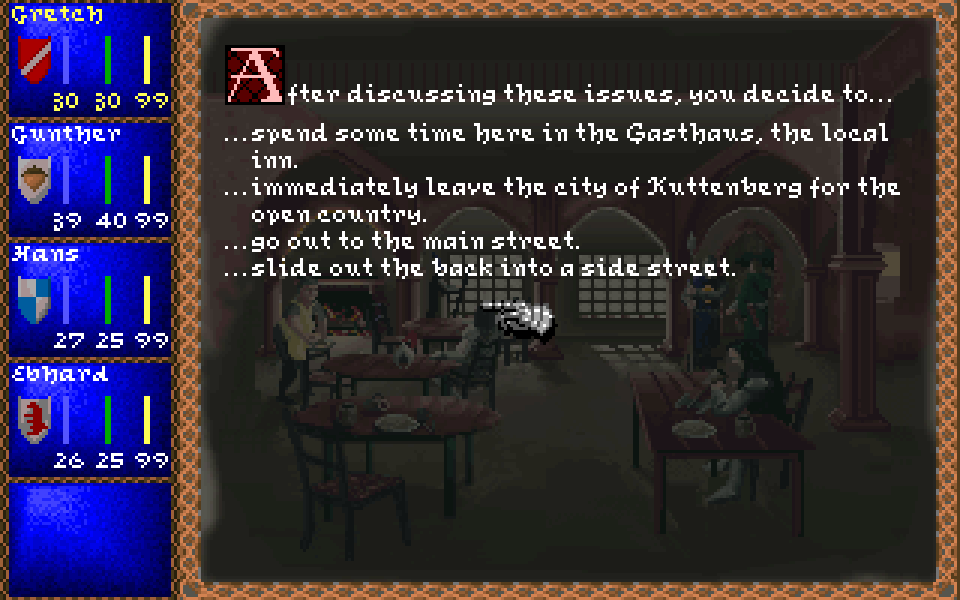
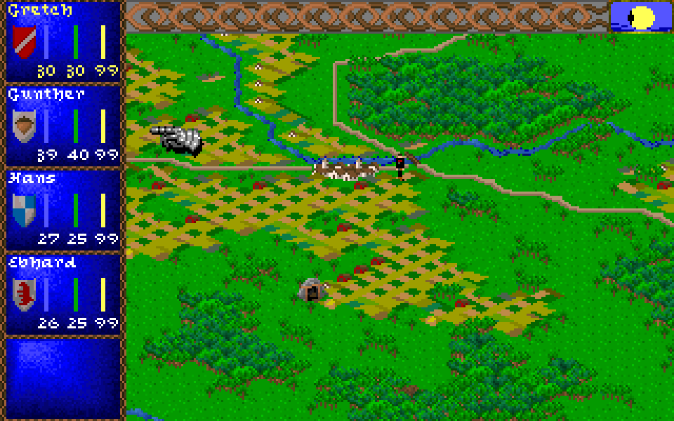
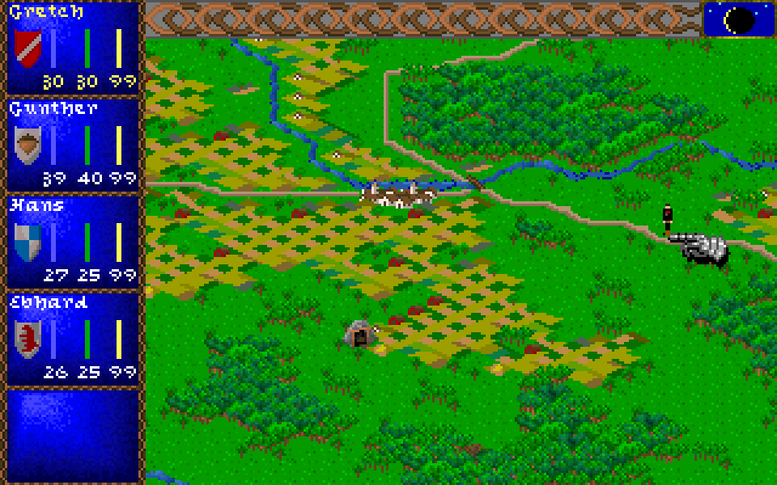
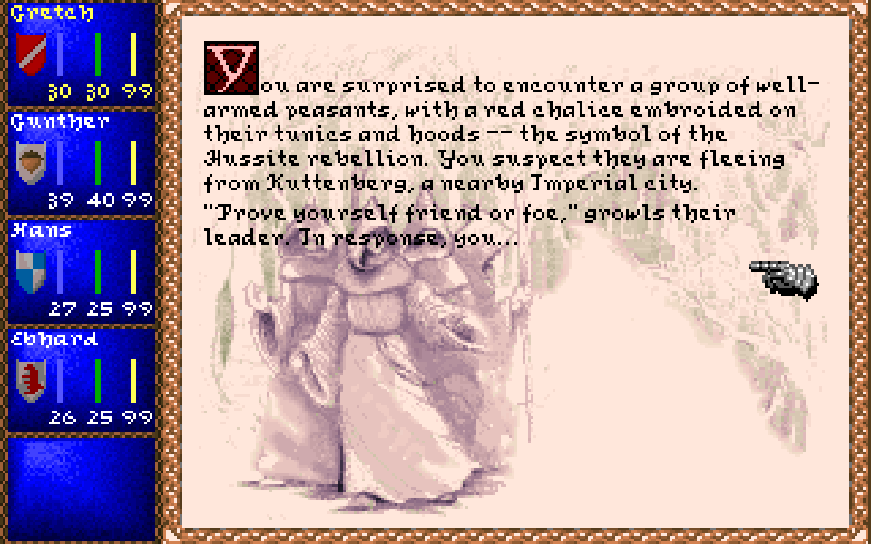
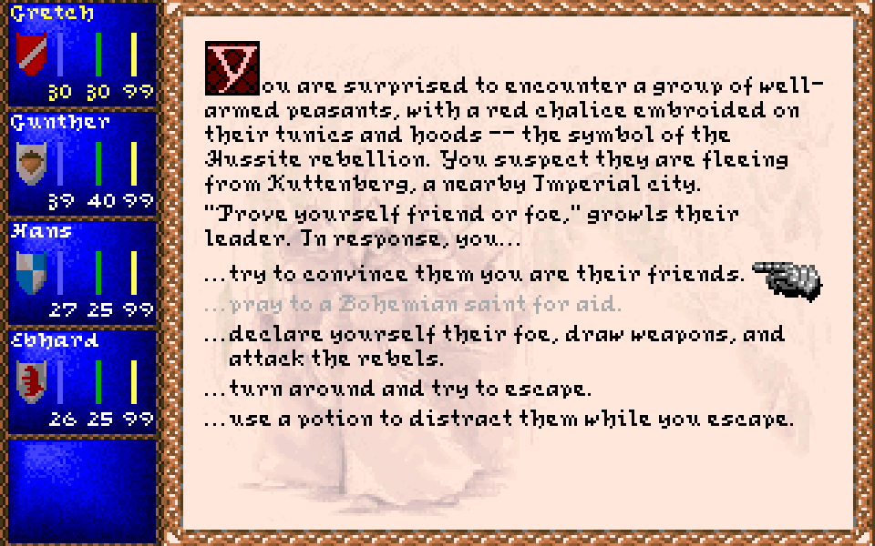
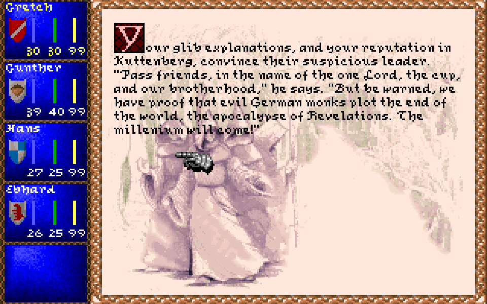
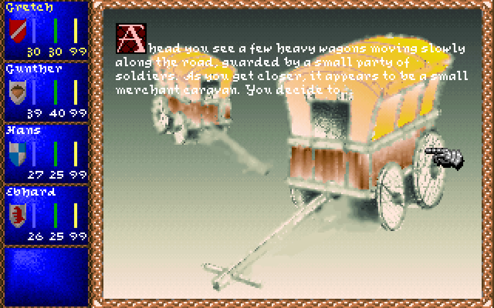

# The Hussite band on the road

**Restored only; Original and Fixed are unchanged.** [Back to the list of what Restored adds](../RESTORED.md)

## What it is

On the roads of Bohemia the party can meet a band of armed peasants wearing the red chalice of the Hussite rebellion,
who demand to know whether it is friend or foe. The releases 483.04 to 483.06 of 1992 had this encounter on the road.
The last release, 483.07, took it out of the road's encounters but kept the scene, its texts, its battle and the war it
starts. Restored puts it back.

## How to find it

- **Where:** on a road whose nearest city is St. Joachimsthal, Buerglitz, Prag, Kuttenberg or Bruenn.
- **When:** at any time, travelling or resting on the road (rest with A or F7 on the map).
- **How often:** encounters on a road come now and then. Near these five cities, about one road encounter in seven is
  the Hussite band, in place of the merchant caravan the road gives there in Original.
- **What the party needs:** nothing.

## What happens

The text names the city the band comes from: the nearest of the five. The party can:

- **convince them it is their friend:** the chance comes from the leader's charisma, half the leader's Speak Common
  and the party's standing in that city. If it works, the band lets the party pass, the city's opinion of the party
  rises and the leader's speech improves. If not, they attack;
- **pray to a Bohemian saint:** an answered prayer lets the party pass. Two of the saints impress the rebels even
  unanswered; for the other two, an unanswered prayer starts the fight;
- **declare itself their foe and attack:** a battle with the rebels;
- **turn around and run:** the chance is the party's agility, and a mounted party always gets away. A failed run
  ends in the fight;
- **throw a potion to distract them and run.**

Meeting the band the first time marks the city as risen and preparing for war. Its gossip, its docks and the boats
that land there then speak of it.

## Screenshots

Taken in play: a Quick Start game that began in Kuttenberg. The party leaves the city for the open country, walks
to the road east of the city and rests there until the band comes. Nothing was set by hand.

The inn of Kuttenberg, where the game began:

The open country around Kuttenberg:

The party on the road east of the city:

The band:

The party convinces them it is their friend:

**In Original** the same game, on the same road at the same moment, meets a merchant caravan:

## Where it comes from

The road's encounter table of 483.04 to 483.06 met the band near the five Bohemian cities. 483.07 removed that one
branch and kept the card, its texts, picture and battle, and the wartime that the gossip, the docks and the boats
read. Register row R-13ad91, in [RESTORATION.md](../faithfulness/RESTORATION.md#in-the-restored-rule-set).

## Since

The first release that offers the Restored rules (planned for 1.2).
