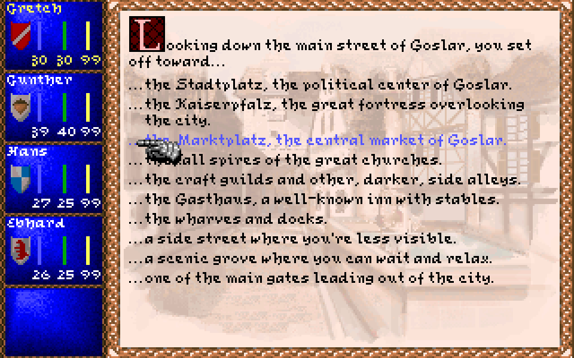
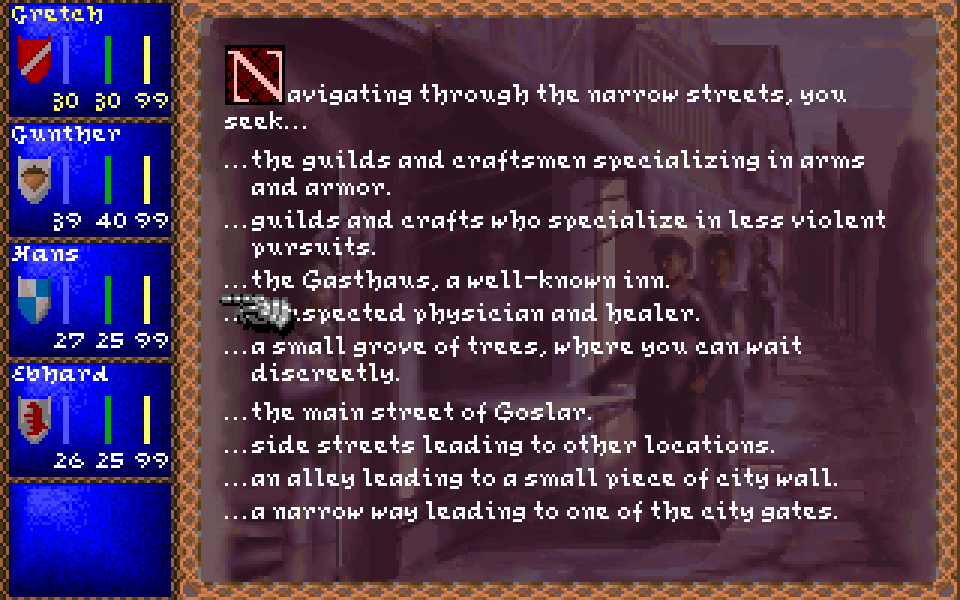
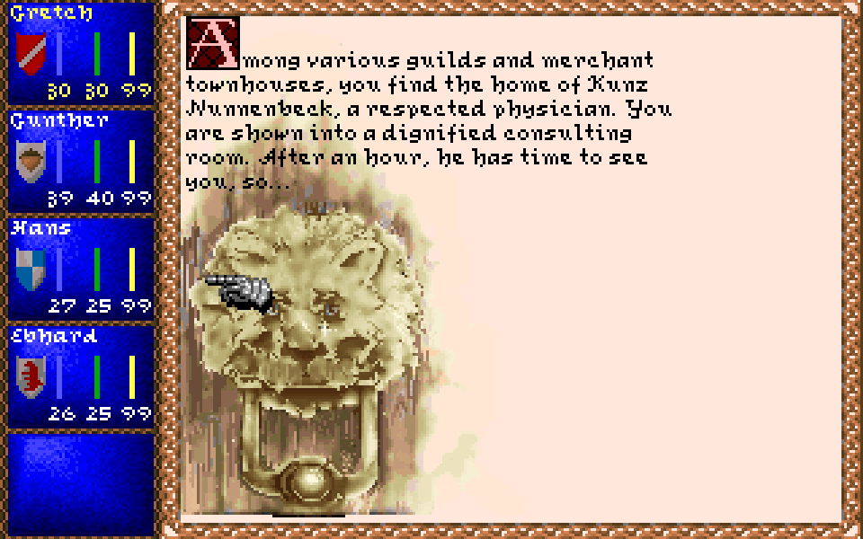
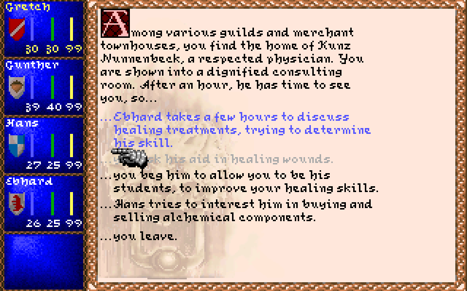
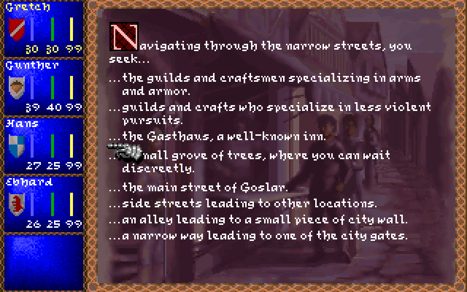

# The physician's second door

**Restored only; Original and Fixed are unchanged.** [Back to the list of what Restored adds](../RESTORED.md)

## What it is

A city's business district gets a line to the house of a respected physician and healer. The 1992 game has the line,
its text and the way to the house, but never offers it there; the house is reached only through the crafts quarter.
Restored offers the line, so the physician can be found from both districts.

## How to find it

- **Where:** any city. From the main street, choose "...the craft guilds and other, darker, side alleys." (the business
  district).
- **When:** on every visit, by day or by night.
- **What the party needs:** nothing.
- **Exception:** in a smaller city, the physician cannot be found in one year out of three. The same rule hides him
  in the crafts quarter that year.

The district's list then includes "...a respected physician and healer."

## What happens

The line leads to the physician's house, the same house the crafts quarter leads to, with the same choices. A member
can talk with him about healing to learn his skill, ask for treatment of wounds (for a fee), ask to study under him,
or offer to trade alchemical components. Or the party can leave.

## Screenshots

Taken in play: a Quick Start game in Goslar, walking from the inn.

The main street of Goslar. The business district is "...the craft guilds and other, darker, side alleys.":

The business district in Restored, with the physician's line:

The physician's house:

**In Original** the same district has no physician's line:

## Where it comes from

The line, its text and its way to the house are in the 1992 game's own files; the business district never offers it.
Register row R-5a84a7, in [RESTORATION.md](../faithfulness/RESTORATION.md#in-the-restored-rule-set).

## Since

The first release that offers the Restored rules (planned for 1.2).
