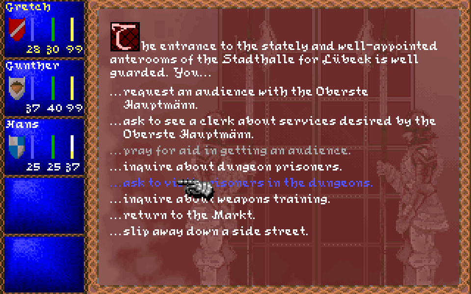
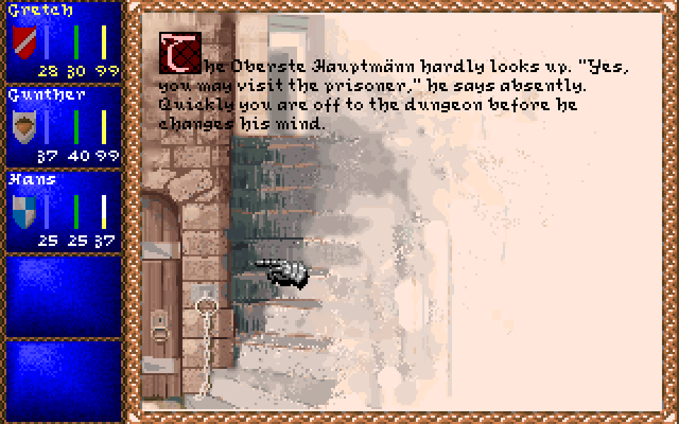
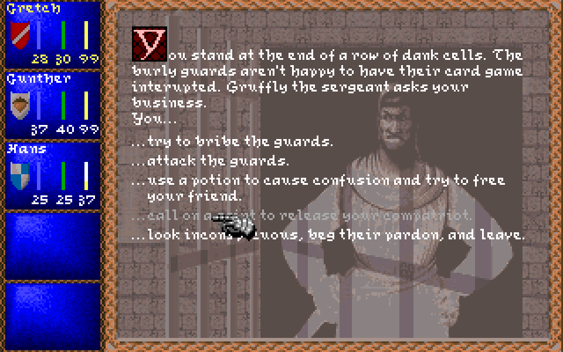
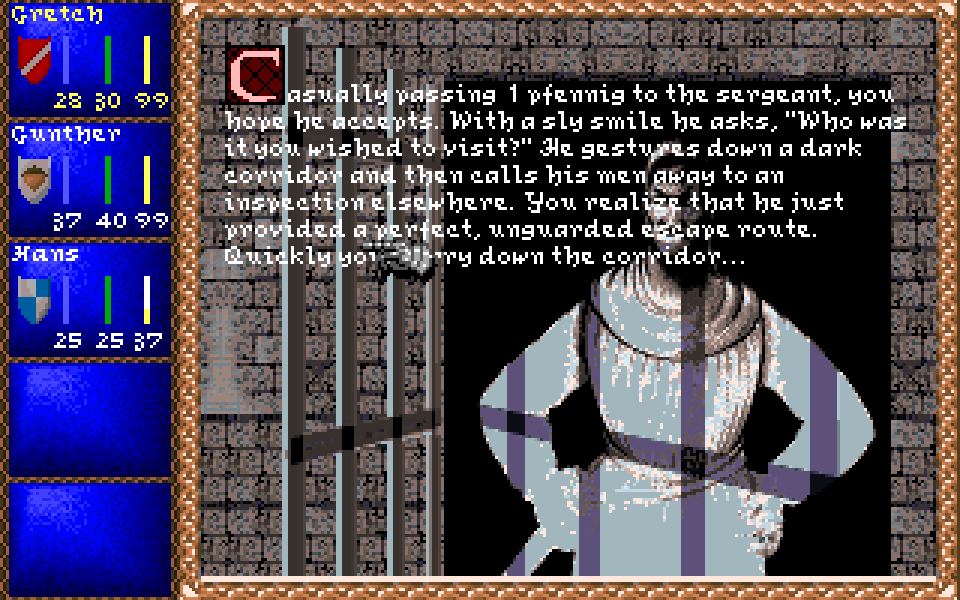
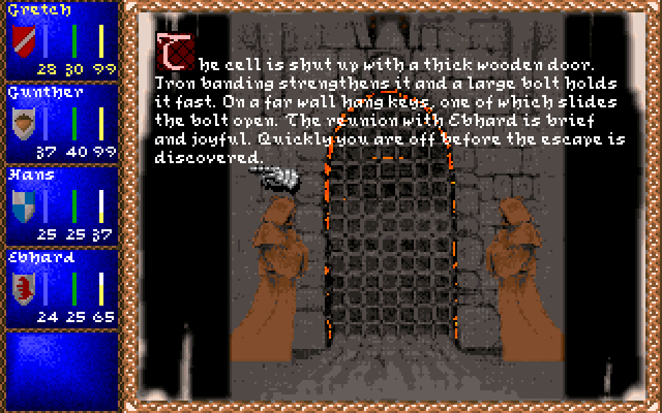
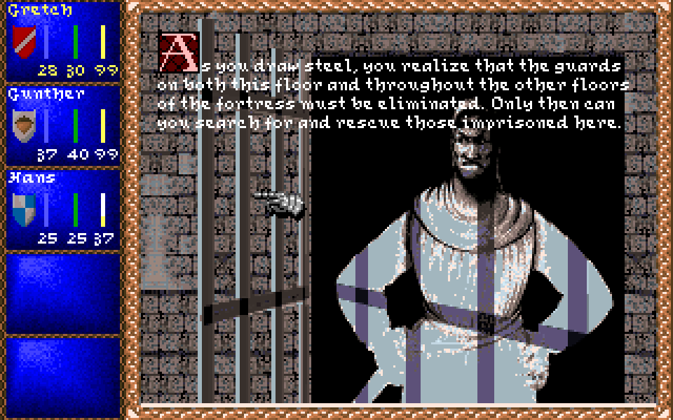
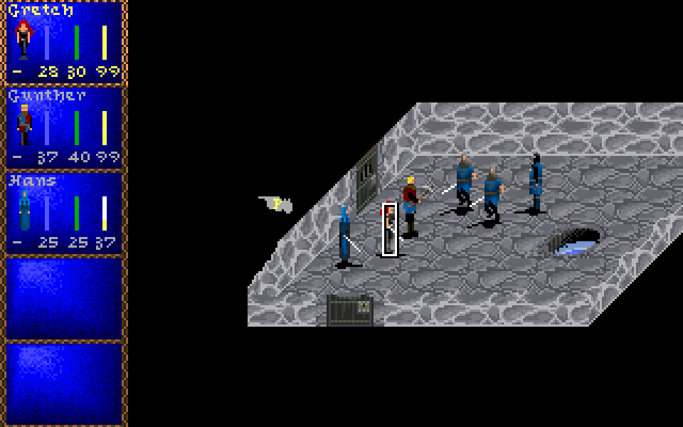
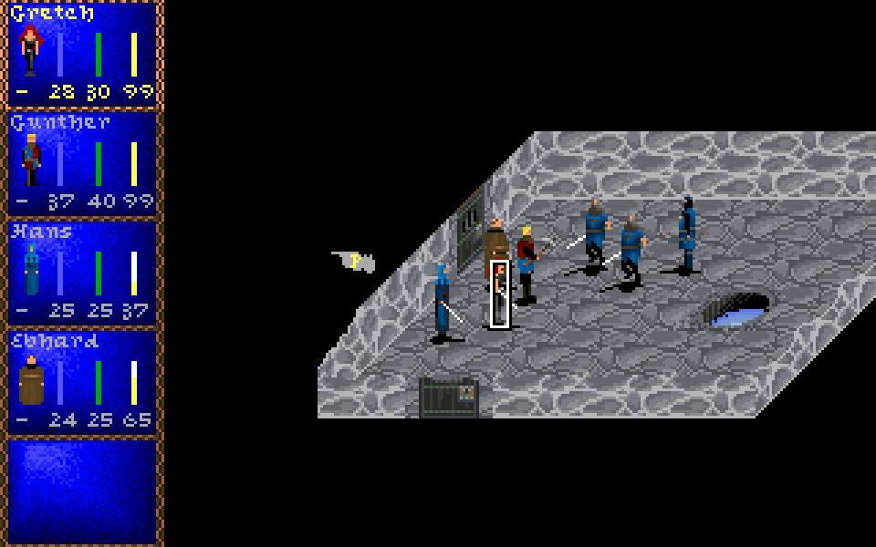
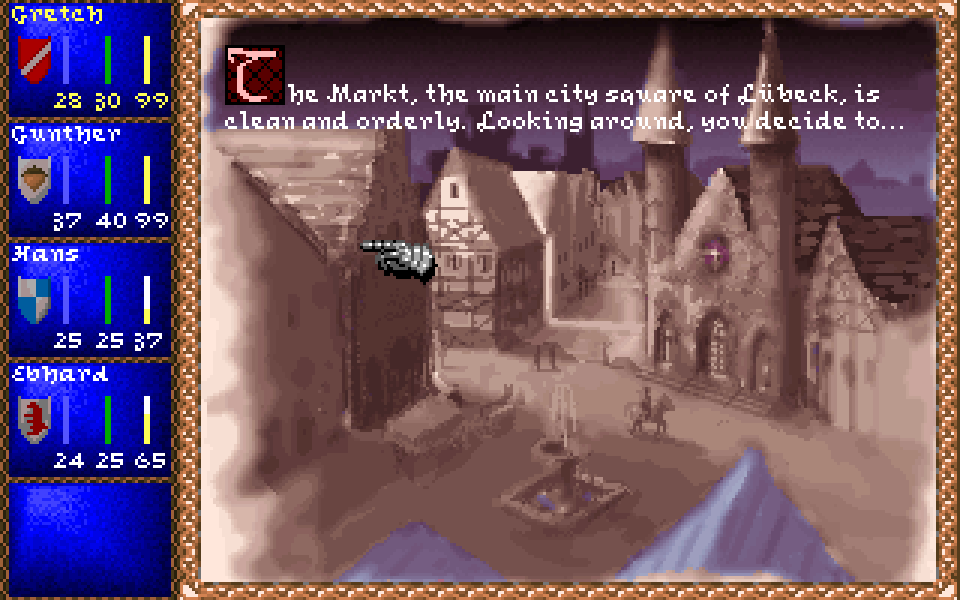

# The prison rescue

**Restored only; Original and Fixed are unchanged.** [Back to the list of what Restored adds](../RESTORED.md)

## What it is

When a companion is held in a city's prison, the party can try to free them at the cells: by bribing the guards,
attacking them, throwing a potion or calling on a saint. The last release of 1992 (483.07) frees the companion the
moment a bribe is paid or steel is drawn, even before a fight the party then loses. Restored follows the earlier
releases (483.04 to 483.06) and uses a text 483.07 wrote but never showed:

- a bribe that works leads to the freed companion's own scene: the cell, the keys, the reunion;
- attacking first tells the party that the guards of every floor must fall before the cells can be searched. Then
  comes the fight, and only a won fight leads to the reunion;
- a lost fight or a flight frees nobody.

The potion and the saint free the companion at once in every release, and still do.

## How to find it

- **Who is held:** a member the party left behind in a fight in a city. If the party flees or leaves the battlefield
  while a member is still standing on it, that member is taken and held in the city's prison for up to a year.
- **Where:** that city. By day, the town hall: "...ask to visit prisoners in the dungeons." (a city hostile to the
  party may turn the party away). At night, the main square offers a way to the prison windows, which needs some
  stealth.
- **What the party needs:** 5 florins for the bribe. Without them, the guards attack.
- **How often:** on each visit, while the companion is held.

## What happens

- **Bribe:** the guards take 5 florins, and the party is shown down a dark corridor to the cell; the companion
  rejoins. The bribe's text names the sum the last scene left in it, not the 5 florins (here, 1 pfennig), as in the
  original.
- **Attack:** the "guards of every floor" text, then the fight with three to seven guards. Won: the cell scene and the
  companion rejoins. Lost: the party is thrown into the city's dungeon. Fled: the party escapes without the companion.
  Either way the city turns against the party.
- **Potion, saint:** as in every release. If they work, the companion is freed. If they fail, the guards attack.

## Screenshots

Taken in play from a 1999 community save of the default party, in Lübeck's Ratskeller by day.
**Ebhard was put in Lübeck's prison with the developer console** (`prisoner 4`). In a game, a member is held there
after the party leaves a city fight without them, as described above. Everything after that is played: the walk to
the town hall, the visit, the choices.

The town hall, with the lines a held companion adds:

The visit is allowed:

The cells and their choices:

**The bribe.** It works:

The freed companion's scene. Ebhard is back in the party:

**The attack.** The guards of every floor must fall first:

The fight begins. Ebhard is still a prisoner, not in the party:

A won fight then leads to the same scene as the bribe.

**In Original** the attack frees the companion before the fight: Ebhard is already in the party when it begins,
and stays free even if the fight is lost:

and the bribe goes straight back to the square, without the reunion scene:

## Where it comes from

The earlier releases of 1992 (483.04 to 483.06) lead the bribe and the won fight to the reunion scene, which 483.07
still holds but no longer shows. The "guards of every floor" text is 483.07's own, written but shown nowhere. Register
row R-b3f475, in [RESTORATION.md](../faithfulness/RESTORATION.md#in-the-restored-rule-set).

## Since

The first release that offers the Restored rules (planned for 1.2).
